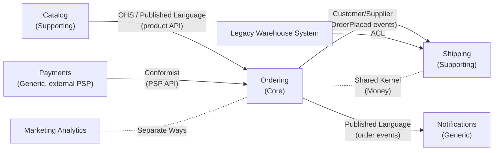
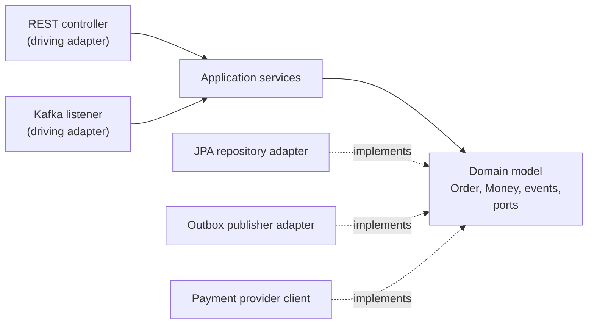

Domain-Driven Design (DDD) is an approach to building software in which the structure and language of the code mirror the business domain it serves. Instead of starting with tables, controllers, or frameworks, you start with the problem: what the business does, which words its experts use, which rules must never be broken, and where one part of the business stops and another begins. The code is then shaped around that understanding.

The term comes from Eric Evans's 2003 book *Domain-Driven Design: Tackling Complexity in the Heart of Software*, often called the "Blue Book". Evans described both the strategic side of DDD (how to split a large system into models with clear boundaries) and the tactical side (building blocks such as entities, value objects, aggregates, and repositories). Ten years later, Vaughn Vernon's *Implementing Domain-Driven Design* (2013), the "Red Book", showed how to apply these ideas in real codebases, with more detail on aggregate design, domain events, and integrating bounded contexts.

This article walks through both sides of DDD using one running example: an e-commerce company that takes orders, charges customers, and ships parcels. All code is Java 17+.

## Why DDD Exists

Business software rarely fails because the framework is wrong. It fails because the code stops matching how the business works: rules get scattered across controllers, SQL, and batch jobs, the same word means different things in different modules, and a small change to discounts touches fifteen files.

DDD tackles that complexity in three ways:

1. **Shared language.** Developers and domain experts use the same terms, and those terms appear in the code.
2. **Explicit boundaries.** A large domain is split into smaller models, each consistent within its own boundary.
3. **Behaviour lives with data.** Domain objects enforce business rules themselves.

### When DDD Is Worth It, and When It Isn't

DDD costs time with domain experts and more classes than a CRUD layer. It pays off when:

- The business rules are complex and change often (pricing, insurance underwriting, logistics, trading).
- The domain is a source of competitive advantage, so getting it right matters.
- Several teams work on the same system and need clear ownership boundaries.

It's usually overkill when:

- The application is mostly forms over a database, with little logic in between.
- The domain is generic and solved by an off-the-shelf product (payroll, authentication).

A useful test: if you removed the database and the UI, would much be left to model? If not, plain CRUD is the better choice. You can also mix approaches within one system.

## Strategic Design

Strategic design is about understanding the domain, dividing it, and deciding how the parts talk to each other. Evans and Vernon both stress that this is where most of the value is.

### Ubiquitous Language

The **ubiquitous language** is a shared vocabulary built by developers and domain experts together, and used everywhere: in conversations, documentation, tests, and code. If the fulfilment team says "an order is *placed*, then *confirmed* once payment is captured, then *shipped*", the code should say exactly that:

```java
order.place();
order.confirm(paymentId);
order.markShipped(trackingNumber);
```

Not `order.setStatus(2)`. When the code uses the business's words, domain experts can read tests and spot wrong rules, and developers stop translating between two vocabularies.

### Domains and Subdomains

The **domain** is the area of business the software serves, here online retail. It splits into **subdomains**, and DDD classifies them into three kinds:

| Subdomain type | Description | E-commerce example | Investment |
|---|---|---|---|
| Core | What makes the business different and gives it an edge | Ordering and pricing rules, promotions | Best developers, full DDD, built in-house |
| Supporting | Needed and specific to the business, but not a differentiator | Inventory reservation, returns handling | Simpler modelling, built in-house or outsourced |
| Generic | Solved problems that every business has | Payments, identity, email, tax calculation | Buy or use a SaaS or open-source product |

This tells you where to spend modelling effort. Rich aggregates belong in the core; payments should usually be a thin wrapper around a provider like Stripe or Adyen.

### Bounded Contexts

A **bounded context** is an explicit boundary within which a particular model, and its language, applies consistently. It's the central pattern of strategic DDD.

Consider the word "product". In the **Catalog** context, a product has a description, images, categories, and SEO metadata. In **Ordering**, it's a line item with a SKU, quantity, and the price agreed at checkout. In **Shipping**, it's a parcel with a weight and dimensions. Trying to build one `Product` class that serves all three gives you a bloated object that every team is scared to change.

DDD instead accepts that each context has its own model:

```java
// Catalog context
package com.shop.catalog.domain;
public record Product(ProductId id, String title, String description,
                      List<ImageUrl> images, CategoryId category) { }

// Ordering context
package com.shop.ordering.domain;
public record OrderLine(Sku sku, int quantity, Money unitPrice) { }

// Shipping context
package com.shop.shipping.domain;
public record PackageItem(Sku sku, Weight weight, Dimensions dimensions) { }
```

They share only the SKU, and each context evolves independently. A bounded context often maps to one team, but it's a model boundary first, not a deployment one.

Subdomains describe the problem space; bounded contexts describe the solution space. Ideally they line up one-to-one.

### Context Mapping

A **context map** documents how bounded contexts relate, technically and organisationally. The common patterns are:

- **Shared Kernel.** Two contexts jointly own a tiny part of the model, such as `Money`.
- **Customer/Supplier.** The upstream supplier plans around the downstream customer's needs.
- **Conformist.** The downstream adopts the upstream's model as is, because it has no influence (typical with large vendors).
- **Anti-Corruption Layer (ACL).** The downstream translates a foreign or legacy model so it doesn't leak in.
- **Open Host Service (OHS).** The upstream offers a well-defined API for any number of consumers.
- **Published Language.** A documented exchange format, such as a versioned JSON or Avro event schema.
- **Separate Ways.** The contexts don't integrate, because it isn't worth it.

Here's a context map for the shop:



## Tactical Design

Tactical design is about the building blocks you use inside a single bounded context. All examples below sit in the **Ordering** context.

### Value Objects

A **value object** is defined by its attributes, has no identity, and is immutable. Two `Money` values of 10.00 EUR are interchangeable. Java records are a natural fit:

```java
package com.shop.ordering.domain;

import java.math.BigDecimal;
import java.math.RoundingMode;
import java.util.Currency;
import java.util.Objects;

public record Money(BigDecimal amount, Currency currency) {

    public Money {
        Objects.requireNonNull(amount, "amount");
        Objects.requireNonNull(currency, "currency");
        if (amount.signum() < 0) {
            throw new IllegalArgumentException("Money cannot be negative");
        }
        amount = amount.setScale(currency.getDefaultFractionDigits(), RoundingMode.HALF_EVEN);
    }

    public static Money of(String amount, String currencyCode) {
        return new Money(new BigDecimal(amount), Currency.getInstance(currencyCode));
    }

    public static Money zero(Currency currency) {
        return new Money(BigDecimal.ZERO, currency);
    }

    public Money plus(Money other) {
        requireSameCurrency(other);
        return new Money(amount.add(other.amount), currency);
    }

    public Money times(int multiplier) {
        return new Money(amount.multiply(BigDecimal.valueOf(multiplier)), currency);
    }

    public boolean isGreaterThan(Money other) {
        requireSameCurrency(other);
        return amount.compareTo(other.amount) > 0;
    }

    private void requireSameCurrency(Money other) {
        if (!currency.equals(other.currency)) {
            throw new IllegalArgumentException("Currency mismatch: " + currency + " vs " + other.currency);
        }
    }
}
```

The compact constructor makes an invalid `Money` impossible, operations return new instances, and records provide value-based `equals` and `hashCode`. Small typed values also cure primitive obsession: `ship(OrderId, ShippingAddress)` can't be called with arguments in the wrong order, unlike `ship(String, String)`.

```java
public record OrderId(UUID value) {
    public OrderId {
        Objects.requireNonNull(value, "value");
    }
    public static OrderId newId() {
        return new OrderId(UUID.randomUUID());
    }
}

public record Sku(String value) {
    public Sku {
        if (value == null || !value.matches("[A-Z0-9-]{4,20}")) {
            throw new IllegalArgumentException("Invalid SKU: " + value);
        }
    }
}
```

`CustomerId`, `PaymentId`, `TrackingNumber`, and `ShippingAddress` follow the same pattern.

### Entities

An **entity** has an identity that persists while its attributes change, so equality is based on identity:

```java
public class OrderLine {

    private final OrderLineId id;
    private final Sku sku;
    private int quantity;
    private final Money unitPrice;

    OrderLine(OrderLineId id, Sku sku, int quantity, Money unitPrice) {
        if (quantity <= 0) throw new IllegalArgumentException("Quantity must be positive");
        this.id = id;
        this.sku = sku;
        this.quantity = quantity;
        this.unitPrice = unitPrice;
    }

    void increaseBy(int extra) {
        this.quantity += extra;
    }

    Money subtotal() {
        return unitPrice.times(quantity);
    }

    Sku sku() { return sku; }
    int quantity() { return quantity; }

    @Override
    public boolean equals(Object o) {
        return o instanceof OrderLine other && id.equals(other.id);
    }

    @Override
    public int hashCode() {
        return id.hashCode();
    }
}
```

Notice that the constructor and mutators are package-private. Only the `Order` aggregate root in the same package can create or change order lines, as the next section explains.

### Aggregates and Aggregate Roots

An **aggregate** is a cluster of entities and value objects treated as a single unit for data changes. One entity is the **aggregate root**, and it's the only object outside code may hold a reference to. Every change goes through the root, which makes sure the aggregate's **invariants** (rules that must always be true) hold after every operation.

For our `Order`, the invariants are:

- An order can have at most 50 lines.
- Lines can only be added while the order is a draft.
- An order can't be placed without lines, and its total must not exceed the customer's credit limit set at checkout.
- An order can only be shipped after it's confirmed.

A sealed interface models the status, so the compiler knows every possible state:

```java
public sealed interface OrderStatus
        permits OrderStatus.Draft, OrderStatus.Placed, OrderStatus.Confirmed,
                OrderStatus.Shipped, OrderStatus.Cancelled {

    record Draft() implements OrderStatus { }
    record Placed(Instant placedAt) implements OrderStatus { }
    record Confirmed(Instant confirmedAt, PaymentId paymentId) implements OrderStatus { }
    record Shipped(Instant shippedAt, TrackingNumber trackingNumber) implements OrderStatus { }
    record Cancelled(Instant cancelledAt, String reason) implements OrderStatus { }
}
```

And here is the aggregate root:

```java
package com.shop.ordering.domain;

public class Order {

    private static final int MAX_LINES = 50;

    private final OrderId id;
    private final CustomerId customerId;
    private final List<OrderLine> lines = new ArrayList<>();
    private ShippingAddress shippingAddress;
    private OrderStatus status = new OrderStatus.Draft();
    private final List<DomainEvent> pendingEvents = new ArrayList<>();

    Order(OrderId id, CustomerId customerId, ShippingAddress shippingAddress) {
        this.id = Objects.requireNonNull(id);
        this.customerId = Objects.requireNonNull(customerId);
        this.shippingAddress = Objects.requireNonNull(shippingAddress);
    }

    public void addLine(Sku sku, int quantity, Money unitPrice) {
        requireDraft();
        lines.stream()
             .filter(line -> line.sku().equals(sku))
             .findFirst()
             .ifPresentOrElse(
                 line -> line.increaseBy(quantity),
                 () -> {
                     if (lines.size() >= MAX_LINES) {
                         throw new OrderRuleViolation("An order cannot have more than " + MAX_LINES + " lines");
                     }
                     lines.add(new OrderLine(OrderLineId.newId(), sku, quantity, unitPrice));
                 });
    }

    public void place(Money creditLimit, Clock clock) {
        requireDraft();
        if (lines.isEmpty()) {
            throw new OrderRuleViolation("Cannot place an empty order");
        }
        if (total().isGreaterThan(creditLimit)) {
            throw new OrderRuleViolation("Order total exceeds credit limit");
        }
        Instant now = clock.instant();
        status = new OrderStatus.Placed(now);
        pendingEvents.add(new OrderPlaced(id, customerId, total(), lineSnapshots(), now));
    }

    public void confirm(PaymentId paymentId, Clock clock) {
        if (!(status instanceof OrderStatus.Placed)) {
            throw new OrderRuleViolation("Only placed orders can be confirmed");
        }
        status = new OrderStatus.Confirmed(clock.instant(), paymentId);
        pendingEvents.add(new OrderConfirmed(id, paymentId, clock.instant()));
    }

    public void markShipped(TrackingNumber trackingNumber, Clock clock) {
        if (!(status instanceof OrderStatus.Confirmed)) {
            throw new OrderRuleViolation("Only confirmed orders can be shipped");
        }
        status = new OrderStatus.Shipped(clock.instant(), trackingNumber);
        pendingEvents.add(new OrderShipped(id, trackingNumber, clock.instant()));
    }

    public void cancel(String reason, Clock clock) {
        if (status instanceof OrderStatus.Shipped || status instanceof OrderStatus.Cancelled) {
            throw new OrderRuleViolation("Order can no longer be cancelled");
        }
        status = new OrderStatus.Cancelled(clock.instant(), reason);
        pendingEvents.add(new OrderCancelled(id, reason, clock.instant()));
    }

    public Money total() {
        Currency currency = lines.isEmpty() ? Currency.getInstance("EUR") : lines.get(0).subtotal().currency();
        return lines.stream().map(OrderLine::subtotal).reduce(Money.zero(currency), Money::plus);
    }

    public List<DomainEvent> pullEvents() {
        List<DomainEvent> events = List.copyOf(pendingEvents);
        pendingEvents.clear();
        return events;
    }

    private void requireDraft() {
        if (!(status instanceof OrderStatus.Draft)) {
            throw new OrderRuleViolation("Order can only be changed while in draft");
        }
    }

    private List<OrderPlaced.Line> lineSnapshots() {
        return lines.stream().map(l -> new OrderPlaced.Line(l.sku(), l.quantity())).toList();
    }

    public OrderId id() { return id; }
    public CustomerId customerId() { return customerId; }
    public OrderStatus status() { return status; }
    public List<OrderLine> lines() { return List.copyOf(lines); }
}
```

There are no public setters. Outside code can't add a 51st line, skip from draft to shipped, or change a line's quantity directly, because the only way in is through methods named after business operations. The `Clock` parameter keeps the aggregate testable without static calls to `Instant.now()`.

### Aggregate Design Rules

Vaughn Vernon's essay series *Effective Aggregate Design* and the Red Book give a few rules of thumb that have held up well:

1. **Protect true invariants inside one aggregate boundary.** Group objects only if a rule must hold between them at the end of every transaction.
2. **Design small aggregates.** Large ones cause lock contention and slow loads. An `Order` shouldn't contain the `Customer` or the `Shipment`.
3. **Reference other aggregates by identity only.** `Order` holds a `CustomerId`, not a `Customer`.
4. **Use eventual consistency outside the boundary.** To reserve stock, `Order` publishes an event and Inventory reacts in its own transaction.

In short: one transaction, one aggregate. If a use case seems to need two aggregates changed atomically, ask whether "a few seconds later" is fine. It usually is.

### Domain Events

A **domain event** records something domain experts care about, named in the past tense: `OrderPlaced`, `PaymentCaptured`. Events decouple aggregates and are natural integration points between contexts.

```java
public sealed interface DomainEvent permits OrderPlaced, OrderConfirmed, OrderShipped, OrderCancelled {
    OrderId orderId();
    Instant occurredAt();
}

public record OrderPlaced(OrderId orderId, CustomerId customerId, Money total,
                          List<Line> lines, Instant occurredAt) implements DomainEvent {
    public record Line(Sku sku, int quantity) { }
}

public record OrderConfirmed(OrderId orderId, PaymentId paymentId, Instant occurredAt) implements DomainEvent { }
public record OrderShipped(OrderId orderId, TrackingNumber trackingNumber, Instant occurredAt) implements DomainEvent { }
public record OrderCancelled(OrderId orderId, String reason, Instant occurredAt) implements DomainEvent { }
```

The aggregate collects events in `pendingEvents` while it changes state, and the application service publishes them after saving. This keeps the domain model free of any messaging framework. The publishing side is a simple port:

```java
public interface DomainEventPublisher {
    void publish(List<DomainEvent> events);
}
```

### Repositories

A **repository** gives the illusion of an in-memory collection of aggregates. It loads and saves whole aggregates, always through the root. There's one repository per aggregate, not per table, and its interface belongs to the domain layer:

```java
package com.shop.ordering.domain;

public interface OrderRepository {
    Optional<Order> findById(OrderId id);
    void save(Order order);
    OrderId nextId();
}
```

The domain says what it needs. How it's stored (JPA, JDBC, MongoDB, or an event store) is an infrastructure detail, implemented in an adapter. Avoid adding generic query methods like `findByStatusAndCreatedAtBetween` here. Reporting queries belong to a separate read side, which CQRS formalises.

### Factories

When creating an aggregate takes more than a constructor call, a **factory** puts that logic in one place. It can be a static method on the root or a separate class when it needs collaborators:

```java
package com.shop.ordering.domain;

public class OrderFactory {

    private final OrderRepository orders;

    public OrderFactory(OrderRepository orders) {
        this.orders = orders;
    }

    public Order fromCart(CustomerId customerId, ShippingAddress address, Cart cart) {
        Order order = new Order(orders.nextId(), customerId, address);
        cart.items().forEach(item -> order.addLine(item.sku(), item.quantity(), item.unitPrice()));
        return order;
    }
}
```

Because `Order`'s constructor is package-private, the factory and the repository adapter's mapping code are the only ways to get an instance, so every order starts in a valid draft state.

### Domain Services

Some business logic doesn't naturally belong to any single entity or value object. A **domain service** is a stateless operation expressed in the ubiquitous language. Pricing with promotions is a good example: it involves an order, a customer tier, and a set of active promotions, and none of them should own the rule.

```java
package com.shop.ordering.domain;

public class PricingService {

    public Money priceFor(Sku sku, Money listPrice, CustomerTier tier, List<Promotion> promotions) {
        return promotions.stream()
                .filter(p -> p.appliesTo(sku, tier))
                .reduce(listPrice, (price, p) -> p.applyTo(price), (a, b) -> b);
    }
}

public enum CustomerTier { STANDARD, GOLD, PLATINUM }
```

Unlike a typical Spring "service layer", a domain service knows nothing about transactions, HTTP, or databases. Use them sparingly.

### Application Services

An **application service** coordinates a use case: load the aggregate, call domain methods, save, publish events. It handles transactions and security but contains no business rules.

```java
package com.shop.ordering.application;

public class PlaceOrderService {

    private final OrderRepository orders;
    private final CreditPolicy creditPolicy;
    private final DomainEventPublisher events;
    private final Clock clock;

    public PlaceOrderService(OrderRepository orders, CreditPolicy creditPolicy,
                             DomainEventPublisher events, Clock clock) {
        this.orders = orders;
        this.creditPolicy = creditPolicy;
        this.events = events;
        this.clock = clock;
    }

    public void handle(PlaceOrderCommand command) {
        Order order = orders.findById(command.orderId())
                .orElseThrow(() -> new OrderNotFound(command.orderId()));

        Money creditLimit = creditPolicy.limitFor(order.customerId());
        order.place(creditLimit, clock);

        orders.save(order);
        events.publish(order.pullEvents());
    }
}

public record PlaceOrderCommand(OrderId orderId) { }
```

The transaction boundary (`@Transactional` in Spring) wraps `handle`. `CreditPolicy` is another domain port, perhaps implemented by calling a Customer context.

## Anemic vs Rich Domain Model

Martin Fowler called the **anemic domain model** an anti-pattern in 2003: domain objects are bags of getters and setters, and all logic lives in service classes.

### Before: Anemic Model

```java
@Entity
public class OrderEntity {
    @Id private UUID id;
    private String status;
    private BigDecimal total;
    @OneToMany(cascade = CascadeType.ALL) private List<OrderLineEntity> lines;
    // getters and setters for everything
}

@Service
public class OrderService {

    @Transactional
    public void placeOrder(UUID orderId) {
        OrderEntity order = repo.findById(orderId).orElseThrow();
        if (!"DRAFT".equals(order.getStatus()) || order.getLines().isEmpty()) {
            throw new IllegalStateException("Cannot place order");
        }
        BigDecimal total = order.getLines().stream()
                .map(l -> l.getPrice().multiply(BigDecimal.valueOf(l.getQuantity())))
                .reduce(BigDecimal.ZERO, BigDecimal::add);
        order.setTotal(total);
        order.setStatus("PLACED");
        repo.save(order);
        kafkaTemplate.send("orders", orderId.toString(), "PLACED");
    }
}
```

The problems: any code can call `order.setStatus("SHIPPED")` and skip every rule; the total calculation gets copied into the cart, invoice, and admin screens and drifts; and rules, persistence, and Kafka are tangled together, so testing a rule needs a database and a broker.

### After: Rich Model

The rich version is the `Order` aggregate shown earlier together with `PlaceOrderService`. The rules (draft only, not empty, within credit limit) live in `Order.place`, the total is computed in exactly one place, and the service only orchestrates. Unit tests become plain Java:

```java
@Test
void placingAnOrderRaisesOrderPlaced() {
    Order order = new Order(OrderId.newId(), new CustomerId(UUID.randomUUID()), anAddress());
    order.addLine(new Sku("SHOE-42"), 2, Money.of("49.99", "EUR"));

    order.place(Money.of("1000.00", "EUR"), Clock.systemUTC());

    assertThat(order.pullEvents()).singleElement().isInstanceOf(OrderPlaced.class);
}
```

No Spring context, no database, and the tests read like the rules a domain expert would describe.

## Layered and Hexagonal Architecture with DDD

Evans described a **layered architecture** of user interface, application, domain, and infrastructure layers. Today many DDD teams use Alistair Cockburn's **hexagonal architecture** (ports and adapters), which makes one rule central: **the domain depends on nothing**. Infrastructure depends on the domain, never the reverse, which is the Dependency Inversion Principle at architectural scale.



### Package Structure

A package-by-context, then by layer, layout for the Ordering context:

```text
com.shop.ordering
├── domain                 // pure Java, no Spring or JPA imports
│   ├── Order.java, OrderLine.java, OrderStatus.java
│   ├── Money.java, Sku.java, OrderId.java, OrderPlaced.java ...
│   ├── OrderRepository.java, DomainEventPublisher.java, CreditPolicy.java  // ports
│   └── OrderFactory.java, PricingService.java
├── application
│   └── PlaceOrderService.java, PlaceOrderCommand.java
├── adapter
│   ├── in
│   │   ├── web/OrderController.java
│   │   └── messaging/PaymentEventsListener.java
│   └── out
│       ├── persistence/JpaOrderRepository.java, OrderJpaEntity.java
│       └── messaging/OutboxEventPublisher.java
└── config
    └── OrderingConfiguration.java  // wires everything with Spring
```

You can enforce the "domain imports nothing" rule automatically with a tool such as ArchUnit:

```java
@AnalyzeClasses(packages = "com.shop.ordering")
class ArchitectureTest {

    @ArchTest
    static final ArchRule domainIsFrameworkFree = noClasses()
            .that().resideInAPackage("..domain..")
            .should().dependOnClassesThat()
            .resideInAnyPackage("org.springframework..", "jakarta.persistence..", "..adapter..");
}
```

### Mapping to Spring Boot and JPA

There are two common ways to persist a rich aggregate with JPA.

**Option 1: Annotate the domain model directly.** Less code, but JPA needs no-argument constructors, records can't be entities, lazy-loading proxies surprise you, and the domain is no longer framework-free.

**Option 2: Separate persistence model plus a mapper.** The domain stays pure, and the adapter maps between `Order` and JPA entities:

```java
package com.shop.ordering.adapter.out.persistence;

@Entity
@Table(name = "orders")
class OrderJpaEntity {
    @Id UUID id;
    UUID customerId;
    String status;
    @Embedded AddressEmbeddable shippingAddress;
    @OneToMany(mappedBy = "order", cascade = CascadeType.ALL, orphanRemoval = true)
    List<OrderLineJpaEntity> lines = new ArrayList<>();
    @Version long version;
}

interface SpringDataOrderRepository extends JpaRepository<OrderJpaEntity, UUID> { }

@Repository
class JpaOrderRepository implements OrderRepository {

    private final SpringDataOrderRepository jpa;
    private final OrderMapper mapper;

    JpaOrderRepository(SpringDataOrderRepository jpa, OrderMapper mapper) {
        this.jpa = jpa;
        this.mapper = mapper;
    }

    @Override
    public Optional<Order> findById(OrderId id) {
        return jpa.findById(id.value()).map(mapper::toDomain);
    }

    @Override
    public void save(Order order) {
        jpa.save(mapper.toEntity(order));
    }

    @Override
    public OrderId nextId() {
        return OrderId.newId();
    }
}
```

The `@Version` field gives optimistic locking, which matters a lot with aggregates: if two requests change the same order at the same time, one fails and can retry instead of silently overwriting the other. For the mapper to restore an existing order, the domain needs a way to rebuild an `Order` from stored state, typically a package-private or clearly named static method such as `Order.rehydrate(...)` that skips the creation rules.

Option 2 costs more mapping code, but the domain is testable without a database and schema changes don't ripple into the model. A common compromise is option 1 for simple supporting contexts and option 2 for the core.

## Anti-Corruption Layer Example

The Shipping context has to work with a 15-year-old warehouse management system. Its API returns things like this:

```json
{ "ORD_REF": "A-99812", "STAT_CD": "D", "CARR": "UPS ", "TRK": "1Z999AA10123456784", "WT_LBS": "4.40" }
```

Status codes are single letters, weights are pounds stored as strings, and fields are padded with spaces. If Shipping used this model directly, every class would end up knowing that `"D"` means dispatched. An anti-corruption layer keeps the translation in one place:

```java
package com.shop.shipping.domain;

public interface WarehouseGateway {
    Optional<ParcelStatus> statusOf(ShipmentId shipmentId);
}

public sealed interface ParcelStatus {
    record AwaitingPick() implements ParcelStatus { }
    record Packed(Weight weight) implements ParcelStatus { }
    record Dispatched(Carrier carrier, TrackingNumber trackingNumber, Weight weight) implements ParcelStatus { }
}
```

```java
package com.shop.shipping.adapter.out.warehouse;

class LegacyWarehouseAdapter implements WarehouseGateway {

    private final LegacyWmsClient client;   // generated or hand-written HTTP client

    LegacyWarehouseAdapter(LegacyWmsClient client) {
        this.client = client;
    }

    @Override
    public Optional<ParcelStatus> statusOf(ShipmentId shipmentId) {
        return client.fetch(shipmentId.value()).map(this::translate);
    }

    private ParcelStatus translate(LegacyWmsResponse r) {
        return switch (r.STAT_CD().trim()) {
            case "P" -> new ParcelStatus.AwaitingPick();
            case "K" -> new ParcelStatus.Packed(Weight.fromPounds(r.WT_LBS()));
            case "D" -> new ParcelStatus.Dispatched(
                    Carrier.fromCode(r.CARR().trim()),
                    new TrackingNumber(r.TRK().trim()),
                    Weight.fromPounds(r.WT_LBS()));
            default -> throw new UnknownWarehouseStatus(r.STAT_CD());
        };
    }
}
```

The domain only sees `ParcelStatus` and `Weight`. When the warehouse is replaced, only the adapter changes.

## DDD and Microservices

Bounded contexts are a good starting point for microservice boundaries, because they group things that change together. Splitting by technical layer or by shared noun ("the product service") usually leads to chatty, coupled services. Many teams start with a modular monolith organised by bounded context and extract services only when there's a clear reason.

### Eventual Consistency Between Aggregates

Following the one-aggregate-per-transaction rule, placing an order doesn't reserve stock in the same transaction. Instead:

1. Ordering saves the `Order` and records `OrderPlaced`.
2. Inventory consumes `OrderPlaced` and reserves stock, emitting `StockReserved` or `StockUnavailable`.
3. Payments captures payment and emits `PaymentCaptured`.
4. Ordering reacts by confirming or cancelling the order.

For a short time the system is inconsistent, with an order placed but stock not yet reserved. The business usually accepts this, as long as it settles quickly and failures are handled.

### The Outbox Pattern

There's a classic trap here: you save the order to the database and then publish to Kafka. If the app crashes between the two, the event is lost. If you publish first and the database commit fails, you've announced something that never happened. The **transactional outbox** pattern fixes this by writing the event to an `outbox` table in the *same* database transaction as the aggregate:

```java
@Component
class OutboxEventPublisher implements DomainEventPublisher {

    private final OutboxRepository outbox;
    private final ObjectMapper json;

    OutboxEventPublisher(OutboxRepository outbox, ObjectMapper json) {
        this.outbox = outbox;
        this.json = json;
    }

    @Override
    public void publish(List<DomainEvent> events) {
        // Runs inside the application service's @Transactional boundary
        for (DomainEvent event : events) {
            outbox.save(new OutboxMessage(UUID.randomUUID(),
                    event.orderId().value().toString(),
                    event.getClass().getSimpleName(),
                    json.valueToTree(event).toString(),
                    event.occurredAt()));
        }
    }
}
```

A separate process then reads the outbox and publishes to the broker, either by polling the table or by change data capture with a tool like Debezium. Delivery becomes at-least-once, so consumers must be idempotent, for example by recording processed event IDs.

### Sagas

When a business process spans several services, such as reserve stock, capture payment, then book a courier, a **saga** coordinates it as a sequence of local transactions, each with a **compensating action** if a later step fails (release the stock, refund the payment). Sagas can be *choreographed* through events or *orchestrated* by a central process manager. The idea comes from a 1987 paper by Hector Garcia-Molina and Kenneth Salem.

## CQRS and Event Sourcing

Neither is required for DDD, but both pair well with it.

**CQRS (Command Query Responsibility Segregation)**, a name popularised by Greg Young and building on Bertrand Meyer's command-query separation, splits the write model from the read model. Commands go through aggregates that enforce invariants. Queries read from separate, denormalised views, such as an `OrderSummaryView` record kept up to date from `OrderPlaced` and `OrderShipped` events. This keeps repositories small and stops aggregates being bent out of shape to serve list screens and reports.

**Event sourcing** stores an aggregate as the sequence of events that happened to it rather than its current state. To load an `Order`, you replay `OrderPlaced`, `OrderConfirmed`, `OrderShipped`. You get a full audit trail, at the cost of event versioning and snapshotting. Use it where history is part of the domain (ledgers, compliance), not by default.

## Event Storming

**Event Storming**, created by Alberto Brandolini, is a workshop where developers and domain experts put **domain events** on orange sticky notes along a timeline, add the **commands** and **policies** that link them, mark **hot spots** of disagreement, and then group everything around **aggregates**. Places where the language changes suggest **bounded contexts**.

For the shop, a session quickly surfaces debates like "is an order placed when payment is authorised or when it's captured?", which is exactly what you want settled before writing code.

## Common Mistakes

- **Doing only tactical DDD.** Repositories and value objects without bounded contexts or a ubiquitous language give you ceremony without the benefit.
- **Applying DDD everywhere.** Full modelling for generic or CRUD-heavy subdomains wastes effort.
- **Giant aggregates.** An `Order` containing the `Customer` and the shipment causes locking conflicts and slow loads.
- **Anemic models with DDD names.** An `OrderAggregate` with public setters is still anemic.
- **One shared model across contexts.** A single `Product` class used by every team defeats bounded contexts.
- **Leaking framework concerns into the domain.** JPA and Jackson annotations in domain classes tie the model to infrastructure.
- **Changing several aggregates in one transaction.** It breaks under load or once they move to different services.
- **Publishing events outside the transaction.** Without an outbox, events and state drift apart after a crash.
- **Skipping domain experts.** A model built only by developers reflects developer assumptions, not the business.

## Summary

| Concept | What it is | Example in the shop |
|---|---|---|
| Ubiquitous language | Shared vocabulary used in talk and code | `place()`, `confirm()`, `markShipped()` |
| Bounded context | Boundary where one model applies consistently | Catalog, Ordering, Shipping |
| Context map | Relationships between contexts | ACL between Shipping and the legacy warehouse |
| Value object | Immutable, defined by its values | `Money`, `Sku`, `ShippingAddress` |
| Entity | Has identity that persists over time | `OrderLine` |
| Aggregate root | Consistency boundary and sole entry point | `Order` |
| Domain event | Something that happened that matters | `OrderPlaced`, `OrderShipped` |
| Repository | Collection-like access to aggregates | `OrderRepository` |
| Domain service | Stateless business operation | `PricingService` |
| Application service | Orchestrates a use case, no business rules | `PlaceOrderService` |
| Outbox | Reliable event publishing with state changes | `OutboxEventPublisher` |

## Checklist

Before calling a design "domain-driven", check that:

- [ ] You've identified your core, supporting, and generic subdomains, and your best effort goes to the core.
- [ ] Each bounded context has an explicit boundary, an owner, and its own model.
- [ ] Class and method names come from the ubiquitous language, and domain experts recognise them.
- [ ] Legacy and external integrations go through an anti-corruption layer where needed.
- [ ] Value objects are immutable and validate themselves.
- [ ] Aggregates are small, enforce their own invariants, and expose no public setters.
- [ ] Aggregates reference each other by ID, and each transaction changes only one aggregate.
- [ ] Domain events are named in the past tense and published reliably, for example through an outbox.
- [ ] Application services orchestrate and contain no business rules.
- [ ] The domain package has no framework imports, and an architecture test enforces it.
- [ ] CQRS and event sourcing are used only where they solve a real problem.

Start with the language and the boundaries, put rules where the data lives, and reach for the tactical patterns only where the domain is complex enough to deserve them.
