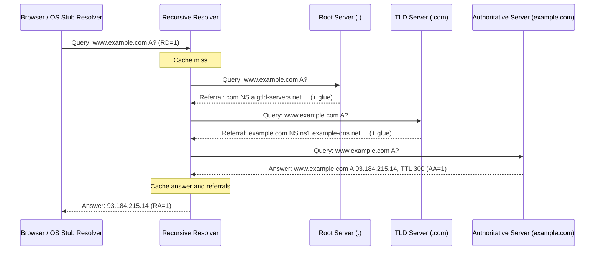

Every time you open a website, send an email, or call an API, your computer first has to answer a simple question: what IP address does this name point to? The system that answers it is the **Domain Name System (DNS)**. It turns human-friendly names like `www.example.com` into machine-friendly addresses like `93.184.215.14` or `2606:2800:21f:cb07:6820:80da:af6b:8b2c`, and it does this billions of times a day, usually in a few milliseconds.

DNS is often called the "phone book of the internet", but that comparison undersells it. DNS is a globally distributed, hierarchical, heavily cached database with no single owner. It also tells mail servers where to deliver email, proves domain ownership to certificate authorities, steers users to the nearest data centre, and lets services inside a Kubernetes cluster find each other.

This article explains how DNS works from the ground up: the namespace, the servers involved, what happens during a lookup, the record types you will meet, caching, the wire protocol, security, and how DNS shows up in system design. It ends with hands-on tools, a Java example, and a troubleshooting checklist.

## Why DNS Exists

In the early days of the ARPANET, every host kept a copy of a single file, `HOSTS.TXT`, that mapped names to addresses. The Stanford Research Institute's Network Information Center (SRI-NIC) maintained the master copy, and hosts downloaded it periodically. You can still see this idea today in `/etc/hosts` on Linux and macOS.

That approach did not scale. Every new host meant editing a central file, names could collide, and the file and its download traffic grew with the network. In 1983, Paul Mockapetris designed DNS to replace it (RFC 882 and RFC 883), and the design was refined in 1987 in **RFC 1034** and **RFC 1035**, which are still the core specifications today.

DNS solved the scaling problem with three ideas:

1. **A hierarchical namespace**, so names are unique without central coordination of every name.
2. **Delegation**, so each organisation manages its own part of the namespace on its own servers.
3. **Caching**, so most queries are answered from nearby memory instead of travelling across the world.

## The DNS Namespace

### A Tree of Labels

DNS names form an inverted tree. Each node in the tree has a **label**, and a domain name is the sequence of labels from a node up to the root, separated by dots.

```
                          . (root)
          /          /          |          \
        com         org        net         in
       /    \         \                      \
  example  google   wikipedia                co
   /    \                                      \
 www    api                                   example
```

Reading `www.example.com` from right to left walks down the tree:

- **Root**: the unnamed top of the tree, written as an empty label (a trailing dot).
- **Top-level domain (TLD)**: `com`. There are generic TLDs (`com`, `org`, `net`, `dev`, `app`), country-code TLDs (`in`, `uk`, `de`), and a special infrastructure TLD, `arpa`, used for reverse DNS.
- **Second-level domain**: `example`, the part you register with a registrar.
- **Subdomain**: `www`, which the owner of `example.com` can create freely. Subdomains can nest as deep as you like, such as `eu.api.staging.example.com`.

A few limits are worth knowing: each label can be at most 63 octets, and a full name can be at most 255 octets on the wire (in practice, about 253 characters when written as text). Names are case-insensitive, so `WWW.Example.COM` and `www.example.com` are the same.

### FQDNs and the Trailing Dot

A **fully qualified domain name (FQDN)** names a node all the way to the root. Strictly speaking, it ends with a dot: `www.example.com.`. That final dot represents the root label.

Browsers and most tools add it silently, so you rarely type it. It matters in two places:

- **Zone files**, where a name without a trailing dot is treated as relative to the zone's origin. Writing `www.example.com` (no dot) inside the `example.com` zone actually means `www.example.com.example.com.`, a classic mistake.
- **Search domains**. When your resolver has search domains configured (common in corporate networks and Kubernetes), a name without a trailing dot may be tried with those suffixes appended first. Adding the dot tells the resolver the name is already complete.

## The Components of DNS

A DNS lookup involves several kinds of software. Understanding who does what makes everything else easier.

### Stub Resolver

The **stub resolver** is the small DNS client built into your operating system (or into an application's runtime). It does not walk the DNS tree itself. It forwards your question to a recursive resolver and waits for a final answer. On Linux, it is configured in `/etc/resolv.conf` (often managed by `systemd-resolved`); on macOS, it is part of `mDNSResponder`; on Windows, it is the DNS Client service.

Before going to the network, the OS also checks the local `hosts` file and its own cache. Browsers often keep a separate cache on top of that.

### Recursive Resolver

The **recursive resolver** (also called a recursive server, caching resolver, or just "the resolver") does the heavy lifting. It accepts a query from a client and takes responsibility for finding the complete answer, asking as many other servers as needed and caching what it learns.

Your resolver is usually provided by your ISP, your company, or your cloud provider (for example, the Amazon VPC resolver or Google Cloud's internal resolver). You can also use public resolvers such as Google Public DNS (`8.8.8.8`), Cloudflare (`1.1.1.1`), or Quad9 (`9.9.9.9`).

### Root Name Servers

The **root servers** serve the root zone, which contains only delegations: for each TLD, it lists the name servers responsible for it. A root server will never tell you the address of `www.example.com`, but it will tell you where to find the servers for `com`.

There are **13 root server identities**, named `a.root-servers.net` through `m.root-servers.net`, operated by 12 independent organisations (Verisign operates two of them). The number 13 comes from history: it let the list of root servers and their addresses fit in a single 512-byte UDP response.

Thirteen names does not mean thirteen machines. Each identity is served from many physical locations using **anycast**, where the same IP address is announced from many places and internet routing delivers your packet to a nearby one. According to root-servers.org, the root server system is made up of well over a thousand instances around the world.

Recursive resolvers ship with a **root hints** file containing the names and addresses of the 13 root servers, so they always know where to start.

### TLD Name Servers

The **TLD servers** are authoritative for a top-level domain. The `com` and `net` TLDs are operated by Verisign; other TLDs are run by their own registry operators. TLD servers do not know the address of `www.example.com` either, but they know which name servers are authoritative for `example.com`, because the registrar told the registry when the domain was registered.

### Authoritative Name Servers

The **authoritative servers** for a domain hold the actual records, such as the `A` record for `www.example.com`. Their answers carry the **AA (Authoritative Answer)** flag. These are run by DNS hosting providers like Amazon Route 53, Cloudflare, Google Cloud DNS, Azure DNS, NS1, or your own BIND, Knot, NSD, or PowerDNS servers.

A domain normally has at least two authoritative servers, ideally on different networks, so a single failure doesn't take the domain offline.

### Forwarders

Many networks add a **forwarder** in the middle, such as your home router or a corporate DNS server, that doesn't recurse itself but passes queries to an upstream recursive resolver and caches the results. To a client, it looks like a recursive resolver.

## How a DNS Lookup Works, Step by Step

Let's follow what happens when you type `www.example.com` into your browser on a machine with nothing cached.

1. **Browser cache.** The browser checks its own DNS cache. Nothing there.
2. **OS stub resolver.** The browser asks the operating system. The OS checks the `hosts` file and its cache. Nothing there either, so the stub resolver sends a query to the configured recursive resolver, with the **RD (Recursion Desired)** flag set.
3. **Recursive resolver cache.** The resolver checks its cache. If another user recently asked for the same name, it answers immediately. Assume it doesn't.
4. **Ask a root server.** The resolver picks a root server and asks for `www.example.com`. The root server replies with a **referral**: "I don't know, but here are the name servers for `com`," along with their addresses.
5. **Ask a TLD server.** The resolver asks one of the `com` servers. It replies with another referral: "Here are the name servers for `example.com`," for example `ns1.example-dns.net` and `ns2.example-dns.net`.
6. **Ask the authoritative server.** The resolver asks one of those servers, which replies with the actual answer: `www.example.com. 300 IN A 93.184.215.14`, with the AA flag set.
7. **Cache and respond.** The resolver caches the answer (and the referrals it collected along the way) for their TTLs, then returns the answer to the stub resolver with the **RA (Recursion Available)** flag set.
8. **Connect.** The OS caches the answer, hands it to the browser, and the browser opens a TCP or QUIC connection to that IP.

In practice, the resolver almost never starts from the root. The `com` delegation is cached for days, so most lookups skip straight to step 5 or 6.



### Recursive vs Iterative Queries

The walkthrough contains two different styles of query:

- A **recursive query** asks the server to return the final answer or an error. The stub resolver sends recursive queries to the recursive resolver. The resolver does all the work.
- An **iterative query** asks the server for the best answer it has right now, which may be a referral to a server closer to the answer. The recursive resolver sends iterative queries to the root, TLD, and authoritative servers and follows the referrals itself.

Root and TLD servers do not offer recursion, which keeps them simple, fast, and hard to abuse.

### QNAME Minimisation

In the classic algorithm, the resolver sends the full name `www.example.com` to the root and the TLD servers, even though they only need to know about `com` or `example.com`. That leaks more information than necessary. **QNAME minimisation** (RFC 7816, updated by RFC 9156) has the resolver ask each server only for the part of the name it needs, for example asking the root only about `com`. Many modern resolvers enable it by default.

## DNS Record Types

DNS stores data as **resource records (RRs)**. Every record has the same shape:

```
<name>              <TTL>  <class>  <type>  <data>
www.example.com.    300    IN       A       93.184.215.14
```

The class is almost always `IN` (Internet). All records with the same name, class, and type form a **resource record set (RRset)**, which is always returned and cached as a unit. Here are the types you will use most.

### A and AAAA

An **A** record maps a name to an IPv4 address; an **AAAA** record maps it to an IPv6 address.

```
www.example.com.   300  IN  A     93.184.215.14
www.example.com.   300  IN  AAAA  2606:2800:21f:cb07:6820:80da:af6b:8b2c
```

A name can have several A or AAAA records. Clients typically try them in turn, and modern clients use **Happy Eyeballs** (RFC 8305) to race IPv6 and IPv4 connections and use whichever succeeds first.

### CNAME

A **CNAME** (canonical name) record says that a name is an alias for another name. The resolver then looks up the target.

```
www.example.com.   3600  IN  CNAME  example.com.cdn-provider.net.
```

CNAMEs are how most CDNs and SaaS platforms let you point your domain at their infrastructure without you knowing their IPs.

CNAMEs have important rules:

- A name with a CNAME **cannot have any other records**. If `www` is a CNAME, it can't also have an MX or TXT record.
- Because of that, **you can't put a CNAME at the zone apex** (the bare domain, `example.com`). The apex must have `SOA` and `NS` records, and a CNAME can't coexist with them.
- Chains of CNAMEs work but add lookups and latency. Keep them short.
- `MX` and `NS` records must point to names that have A/AAAA records, not to CNAMEs.

### ALIAS, ANAME, and CNAME Flattening

Because you can't CNAME the apex, DNS providers invented non-standard workarounds, called **ALIAS** (Route 53, DNSimple and others), **ANAME**, or **CNAME flattening** (Cloudflare). You configure the apex to point to another name, and the authoritative server resolves that target itself and returns plain A and AAAA records to the client. To the outside world, it looks like a normal A record.

These are provider features, not standard record types, so they only work while you use that provider.

### MX

**MX** (mail exchanger) records tell other mail servers where to deliver email for a domain. Each has a preference value; lower values are tried first.

```
example.com.   3600  IN  MX  10  mx1.example.com.
example.com.   3600  IN  MX  20  mx2.example.com.
```

### TXT, SPF, DKIM, and DMARC

**TXT** records hold arbitrary text. They are widely used to prove domain ownership (for example, to Google Workspace or a certificate authority) and for email authentication:

- **SPF** (Sender Policy Framework) lists which servers may send mail for the domain.
- **DKIM** (DomainKeys Identified Mail) publishes a public key used to verify signatures on outgoing mail. It lives under a selector, like `selector1._domainkey.example.com`.
- **DMARC** tells receivers what to do when SPF or DKIM checks fail and where to send reports. It lives at `_dmarc.example.com`.

```
example.com.                  3600 IN TXT "v=spf1 include:_spf.google.com -all"
selector1._domainkey.example.com. 3600 IN TXT "v=DKIM1; k=rsa; p=MIIBIjANBgkq..."
_dmarc.example.com.           3600 IN TXT "v=DMARC1; p=quarantine; rua=mailto:dmarc@example.com"
```

### NS

**NS** records list the authoritative name servers for a zone. They appear in two places: in the parent zone (as the delegation) and in the zone itself (at its apex). The two sets should match.

```
example.com.   86400  IN  NS  ns1.example-dns.net.
example.com.   86400  IN  NS  ns2.example-dns.net.
```

### SOA

Every zone has exactly one **SOA** (Start of Authority) record at its apex, describing the zone itself:

```
example.com. 3600 IN SOA ns1.example-dns.net. hostmaster.example.com. (
    2026102501 ; serial
    7200       ; refresh
    3600       ; retry
    1209600    ; expire
    300        ; minimum (used for negative caching)
)
```

- **MNAME** (`ns1.example-dns.net.`): the primary name server.
- **RNAME** (`hostmaster.example.com.`): the administrator's email address, with the first dot standing for `@`.
- **Serial**: a version number that must increase whenever the zone changes. A common convention is `YYYYMMDDnn`.
- **Refresh, retry, expire**: how often secondary servers check for updates, how soon they retry after a failure, and when they stop serving the zone if they can't reach the primary.
- **Minimum**: today, used to compute how long negative answers are cached (more on that below).

### PTR and Reverse DNS

**PTR** records map an IP address back to a name. This is **reverse DNS**, and it uses the special `arpa` domain. For IPv4, the octets are reversed and placed under `in-addr.arpa`:

```
14.215.184.93.in-addr.arpa.   3600  IN  PTR  www.example.com.
```

For IPv6, each hex digit (nibble) is reversed under `ip6.arpa`. Reverse zones are usually controlled by whoever owns the IP block, such as your ISP or cloud provider, not by the domain owner. Reverse DNS matters most for mail servers, because many receivers distrust mail from IPs without a matching PTR record.

### SRV

**SRV** records advertise the host and port of a service, with a priority and weight for load distribution. The name follows the pattern `_service._protocol.name`:

```
_sip._tcp.example.com.   3600  IN  SRV  10  60  5060  sip1.example.com.
_sip._tcp.example.com.   3600  IN  SRV  10  40  5060  sip2.example.com.
```

Here both targets have priority 10, and traffic is split roughly 60/40 by weight. SRV records are used by SIP, XMPP, LDAP and Active Directory, MongoDB's `mongodb+srv://` connection strings, and Kubernetes services.

### CAA

**CAA** (Certification Authority Authorization, RFC 8659) records list which certificate authorities may issue certificates for a domain. CAs are required to check them before issuing.

```
example.com.   3600  IN  CAA  0 issue "letsencrypt.org"
example.com.   3600  IN  CAA  0 iodef "mailto:security@example.com"
```

### HTTPS and SVCB

**SVCB** and its HTTP-specific form **HTTPS** (RFC 9460) are newer records that let a client learn connection details before it connects: supported protocols (for example, that the server speaks HTTP/3), alternative endpoints and ports, IP hints, and Encrypted Client Hello keys. Unlike CNAME, an HTTPS record can be used at the zone apex in its alias form.

```
example.com.   300  IN  HTTPS  1 . alpn="h3,h2" ipv4hint=93.184.215.14
```

Major browsers already query HTTPS records, which can save a round trip when upgrading to HTTP/3.

## Zones, Delegation, and Glue Records

### Domains vs Zones

A **domain** is a subtree of the namespace. A **zone** is the part of that subtree that one set of authoritative servers manages. They are often the same, but not always. The owner of `example.com` might delegate `eu.example.com` to a separate team, with its own name servers. Then `eu.example.com` is a separate zone, even though it's still part of the `example.com` domain.

### Delegation

**Delegation** happens when a parent zone adds NS records pointing to the child zone's name servers. The root delegates `com` to Verisign's servers, the `com` zone delegates `example.com` to the servers you configured at your registrar, and you can delegate further:

```
; In the example.com zone
eu.example.com.   86400  IN  NS  ns1.eu-team-dns.net.
eu.example.com.   86400  IN  NS  ns2.eu-team-dns.net.
```

When you "change name servers" at your registrar, you are asking the registry to update this delegation in the TLD zone.

### Glue Records

Delegation can create a chicken-and-egg problem. Suppose `example.com` uses `ns1.example.com` as its name server. To find the address of `ns1.example.com`, you need to ask the `example.com` servers, but you can't reach them without that address.

**Glue records** break the loop. The parent zone includes the A/AAAA records of in-zone name servers alongside the NS records, in the additional section of the referral:

```
; In the com zone
example.com.       172800  IN  NS  ns1.example.com.
example.com.       172800  IN  NS  ns2.example.com.
ns1.example.com.   172800  IN  A   192.0.2.53     ; glue
ns2.example.com.   172800  IN  A   198.51.100.53  ; glue
```

Glue is only needed when the name server's name is inside the zone it serves (or below it). If you use your DNS provider's name servers, the provider's own domain already handles this.

### Primary and Secondary Servers

Authoritative servers often run in a **primary/secondary** arrangement. Edits happen on the primary, and secondaries copy the zone using **zone transfers**: a full transfer (**AXFR**) or an incremental one (**IXFR**). The primary can send a **NOTIFY** message so secondaries pull changes immediately rather than waiting for the SOA refresh interval. Zone transfers should be restricted to known secondaries; an open AXFR hands anyone a full list of your hostnames.

## TTLs and Caching

Caching is what makes DNS fast and what keeps the root and TLD servers from being overwhelmed. It is also the source of most "why hasn't my change taken effect?" confusion.

### Time to Live

Every record has a **TTL** in seconds, set by the zone owner. It tells caches how long they may keep the record. A resolver that caches a record with a TTL of 300 counts down from there, and when other clients ask during that time, it returns the record with the remaining TTL.

Choosing a TTL is a trade-off:

| TTL | Pros | Cons |
| --- | --- | --- |
| Short (30-300 s) | Changes and failovers take effect quickly | More queries, slightly higher latency on cache misses, more load on authoritative servers |
| Long (1 h - 1 day) | Fewer queries, faster typical lookups, more resilient if authoritative servers are briefly unreachable | Changes take longer to reach everyone |

Some resolvers enforce a minimum or maximum TTL, so very low TTLs are not always honoured.

### Caching at Every Layer

A single answer may be cached in several places:

1. **The browser** (Chrome, for example, has its own resolver cache, visible at `chrome://net-internals/#dns`).
2. **The operating system** (`systemd-resolved`, `mDNSResponder`, the Windows DNS Client).
3. **The application runtime** (the JVM has its own cache, covered below).
4. **Local forwarders** such as your home router.
5. **The recursive resolver**, which is shared by many users, so popular names are almost always cached.

Each layer has its own rules, which is why flushing one cache doesn't always fix stale results.

### Negative Caching

Resolvers also cache "this doesn't exist" answers. If a name doesn't exist, the authoritative server returns **NXDOMAIN**; if the name exists but has no record of the requested type, it returns **NOERROR with an empty answer** (often called **NODATA**). Either way, it includes the zone's SOA record, and per RFC 2308, the negative answer is cached for the smaller of the SOA record's TTL and its `minimum` field.

This catches people out: if you query a new hostname *before* creating it, resolvers may cache the NXDOMAIN and keep reporting it after you create the record.

### The "DNS Propagation" Myth

You'll often hear that DNS changes take "24 to 48 hours to propagate". DNS doesn't actually push changes anywhere. When you update a record, your authoritative servers serve the new value almost immediately. What takes time is **old cached copies expiring**, which is bounded by the old TTL.

So the practical advice is:

- **Before a planned change**, lower the TTL (for example, from 86400 to 300) and wait at least the *old* TTL for that to take effect.
- **Make the change.** Within about 5 minutes, most clients will see it.
- **Afterwards**, raise the TTL again.

The exception is **name server changes at your registrar**. The NS records in TLD zones often have TTLs of a day or two (172800 seconds in `com`), and resolvers may have cached the old delegation. That is where the folk wisdom of "48 hours" comes from.

### Serve-Stale

Some resolvers support **serve-stale** (RFC 8767): if the authoritative servers can't be reached when a record expires, they keep serving the expired answer for a while instead of failing. This improves resilience during outages of authoritative providers.

## The DNS Wire Protocol

### UDP, TCP, and Port 53

DNS traditionally runs over **UDP port 53**. A query and response usually fit in one packet each, so UDP avoids the cost of a TCP handshake.

The original specification limited UDP responses to **512 bytes**. If an answer doesn't fit, the server sets the **TC (truncated)** flag, and the client retries over **TCP port 53**. TCP is also used for zone transfers. RFC 7766 makes TCP support mandatory for DNS implementations, so blocking TCP/53 on a firewall is a mistake that will break some lookups, especially DNSSEC-signed ones.

### EDNS(0)

512 bytes became too small, especially once DNSSEC signatures were added. **EDNS(0)** (Extension Mechanisms for DNS, RFC 6891) lets a client advertise a larger UDP buffer size and carry extra options using a pseudo-record of type `OPT` in the additional section. It also carries the **DO (DNSSEC OK)** bit and options such as **EDNS Client Subnet**, which some CDNs use to give location-aware answers.

Large UDP responses risk IP fragmentation, which is unreliable and has been used in attacks. The **DNS Flag Day 2020** initiative recommended a default EDNS buffer size of **1232 bytes** to avoid fragmentation, falling back to TCP for anything larger.

### Message Format

Queries and responses share the same format: a 12-byte header followed by four sections.

```
+---------------------+
|       Header        |  ID, flags, and counts for each section
+---------------------+
|      Question       |  The name, type, and class being asked about
+---------------------+
|       Answer        |  RRs that answer the question
+---------------------+
|      Authority      |  NS records (referrals) or SOA (negative answers)
+---------------------+
|      Additional     |  Helpful extras: glue records, the EDNS OPT record
+---------------------+
```

The header contains:

- **ID**: a 16-bit identifier that lets the client match a response to its query.
- **Flags**: `QR` (query or response), `OPCODE` (usually a standard query), `AA` (authoritative answer), `TC` (truncated), `RD` (recursion desired), `RA` (recursion available), `AD` (authenticated data, set by validating resolvers for DNSSEC), `CD` (checking disabled), and `RCODE`.
- **Counts**: the number of records in each of the four sections.

The **RCODE** values you'll see most often:

| RCODE | Meaning |
| --- | --- |
| `NOERROR` | Success (the answer section may still be empty, which means NODATA) |
| `NXDOMAIN` | The name does not exist |
| `SERVFAIL` | The server couldn't produce an answer, for example because authoritative servers were unreachable or DNSSEC validation failed |
| `REFUSED` | The server won't answer this query, for example because it isn't a public resolver |

Names in messages are encoded as a series of length-prefixed labels (`3www7example3com0`), and the protocol uses **name compression** with pointers to earlier occurrences of a name to save space.

## DNS Security

DNS was designed in a friendlier era. The original protocol has no authentication and no encryption, so anyone on the network path can read your queries, and a well-placed attacker can forge answers. Several layers of protection have been added since.

### Cache Poisoning

In a **cache poisoning** attack, an attacker tricks a recursive resolver into caching a forged record, such as pointing `bank.example` to the attacker's server. Every user of that resolver is then sent to the wrong place until the record expires.

With plain UDP, a resolver accepts a response if it arrives from the right IP and port, matches the question, and has the right 16-bit ID. If the attacker can guess those details and get a forged response in before the real one, the resolver accepts it.

### The Kaminsky Attack

In 2008, security researcher Dan Kaminsky disclosed a much more powerful version of this attack. Instead of racing the real answer for one name, which only works when that name isn't cached, the attacker makes the resolver look up a flood of random, non-existent names like `a8f3.bank.example`, `x91k.bank.example`, and so on. Each one is a fresh chance to win the race, and the forged responses include a fake *referral* that hijacks the whole `bank.example` domain.

The industry responded with a coordinated patch that added **source port randomisation**. Resolvers now send each query from a random UDP port, so an attacker has to guess both the 16-bit ID and the port, making blind spoofing vastly harder. Other defences include case randomisation of the query name ("0x20 encoding"), strict checks on which records in a response are accepted ("bailiwick" checks), and, most fundamentally, DNSSEC.

### DNSSEC and the Chain of Trust

**DNSSEC** (DNS Security Extensions) adds cryptographic signatures to DNS data so resolvers can verify that answers are authentic and unmodified. It does **not** encrypt anything. It adds several record types:

- **DNSKEY**: a zone's public keys. Zones commonly use a Key Signing Key (KSK) to sign the DNSKEY set and a Zone Signing Key (ZSK) to sign everything else.
- **RRSIG**: a signature over an RRset.
- **DS** (Delegation Signer): a hash of the child zone's KSK, published in the **parent** zone.
- **NSEC / NSEC3**: signed proof that a name or type doesn't exist, so negative answers can be validated too. NSEC3 uses hashed names to make it harder to list every name in a zone.

Validation follows a **chain of trust** from the root down:

```
Root zone (.)       --- trust anchor: root KSK, built into validating resolvers
   | DS record for com, signed by root
   v
com zone            --- DNSKEY matches the DS in the root
   | DS record for example.com, signed by com
   v
example.com zone    --- DNSKEY matches the DS in com
   | RRSIG over the A record, signed by example.com's ZSK
   v
www.example.com A 93.184.215.14   --> verified
```

The root zone was signed in 2010, and its KSK was rolled over for the first time in 2018. A validating resolver that verifies the chain sets the **AD** flag in its response. If validation fails, it returns **SERVFAIL** instead of a possibly forged answer.

DNSSEC protects the integrity of data between authoritative servers and the validating resolver. Its main costs are operational: keys must be rolled, signatures expire and must be refreshed, and a mistake such as a stale DS record at the registrar makes your whole domain fail to resolve for validating resolvers. Most managed DNS providers now automate this.

### Encrypted DNS: DoT, DoH, and DoQ

DNSSEC proves answers are genuine but leaves queries visible to anyone on the path, such as Wi-Fi operators or ISPs. Three standards encrypt the hop between a client and its recursive resolver:

| Protocol | Standard | Transport | Notes |
| --- | --- | --- | --- |
| **DNS over TLS (DoT)** | RFC 7858 | TLS over TCP port 853 | Dedicated port, easy for network operators to identify (and block). Used by Android's "Private DNS" setting. |
| **DNS over HTTPS (DoH)** | RFC 8484 | HTTPS, usually port 443 | Looks like normal web traffic. Built into major browsers and operating systems. |
| **DNS over QUIC (DoQ)** | RFC 9250 | QUIC over UDP port 853 | Avoids TCP head-of-line blocking and has fast connection setup. |

Encrypted DNS protects queries in transit, but the resolver you choose still sees all of them, so pick one whose privacy policy you trust. In corporate networks, DoH in browsers can bypass internal DNS and security filtering, which is why many organisations manage it through policy.

### DNS Amplification DDoS

DNS is a popular tool for **reflection and amplification** attacks. The attacker sends small queries with a forged source IP (the victim's) to many open resolvers or authoritative servers. Each server sends a much larger response to the victim. Because responses can be many times bigger than queries, a modest amount of attack traffic becomes a flood.

Defences include:

- **Not running open resolvers**: recursive resolvers should only answer their own clients.
- **Response Rate Limiting (RRL)** on authoritative servers.
- **Minimal responses to `ANY` queries** (RFC 8482), which were a favourite of attackers because of their large responses.
- **Source address validation** by networks (BCP 38) so spoofed packets never leave them.

DNS infrastructure is also a direct DDoS target. In October 2016, a large attack by the Mirai botnet against the DNS provider Dyn made many well-known websites unreachable for parts of the day, even though their own servers were fine. This is a strong argument for using more than one authoritative DNS provider for critical domains.

### DNS Hijacking

**DNS hijacking** covers attacks that change where a domain points by compromising something along the chain rather than racing packets:

- **Registrar account takeover**: an attacker logs in to your registrar and changes your name servers. Use strong, unique credentials, multi-factor authentication, and **registry lock** for important domains.
- **DNS provider account compromise**: the same idea at the hosting layer.
- **Router or malware hijacking**: changing a device's DNS settings to a malicious resolver.
- **Dangling records and subdomain takeover**: a CNAME still points to a deleted cloud resource (for example, a removed storage bucket or app hostname) that an attacker can claim, and they then serve content on your subdomain. Clean up DNS records when you tear down infrastructure.

## DNS in System Design

DNS is more than an address book. Because the authoritative server decides what to return, and can return different answers to different clients, it is a powerful traffic-management tool.

### Load Balancing with Multiple Records

The simplest technique is **DNS round robin**: publish several A records for one name, and clients spread across them. It is cheap but crude. DNS has no idea whether a server is healthy, clients and resolvers may pick the same record, and caching means removing a bad server takes up to a TTL. It works best in front of a real load balancer, or combined with health checks.

### Health Checks and Failover

Managed DNS providers like Route 53, Cloudflare, and NS1 can run **health checks** against your endpoints and only return healthy ones. A common pattern is **active-passive failover**: return the primary region's address while it is healthy and switch to the secondary when it fails. Failover speed is limited by the health check interval plus the TTL, which is why these records usually have TTLs of 60 seconds or less.

### GeoDNS and Latency-Based Routing

**GeoDNS** returns different answers depending on where the query comes from, sending users in India to a Mumbai region and users in Germany to Frankfurt. **Latency-based routing** goes a step further and picks the region with the lowest measured latency for that client network.

The authoritative server usually only sees the recursive resolver's IP, not the user's. That works well when users use a nearby ISP resolver, but less well with a distant public resolver. **EDNS Client Subnet (ECS)** lets resolvers pass along a truncated version of the client's address to improve accuracy, at some cost to privacy.

Weighted routing is another variant: send 90% of answers to the current version and 10% to a canary.

### CDNs

CDNs combine these ideas. You point your hostname at the CDN with a CNAME (or an ALIAS at the apex), and the CDN's authoritative servers return the address of an edge location close to the user. Some CDNs do this with GeoDNS, and others announce the same addresses from all locations using anycast and let routing pick the nearest one.

### Anycast

**Anycast** announces the same IP prefix from many locations through BGP, so packets reach the topologically nearest one. It is ideal for DNS, which is mostly short, stateless UDP exchanges. Root servers, TLD servers, public resolvers like `1.1.1.1` and `8.8.8.8`, and every major authoritative DNS provider rely on it for low latency and resilience against DDoS.

### Service Discovery and Kubernetes

Inside data centres, DNS is a natural service discovery mechanism, since every language and library already speaks it. Consul, for example, exposes registered services as DNS names, and AWS Cloud Map does the same for services in a VPC.

In **Kubernetes**, **CoreDNS** (the default cluster DNS since Kubernetes 1.13) gives every Service a name:

```
<service>.<namespace>.svc.cluster.local
```

A pod in the `shop` namespace can reach the `orders` service simply as `orders`, or as `orders.payments` if it lives in the `payments` namespace. For a normal Service, the name resolves to its stable cluster IP. For a **headless Service** (`clusterIP: None`), it resolves to the individual pod IPs, which StatefulSets use to give each pod a stable name like `kafka-0.kafka-headless.shop.svc.cluster.local`. Kubernetes also creates SRV records for named ports.

One well-known Kubernetes gotcha: pods get `options ndots:5` in `/etc/resolv.conf`, along with several search domains. A name with fewer than five dots, such as `api.example.com`, is first tried with each search domain appended, producing several failed lookups before the real one. For heavy traffic to external hostnames, use a trailing dot (`api.example.com.`), lower `ndots` in the pod's `dnsConfig`, or run NodeLocal DNSCache.

## Hands-On: Exploring DNS from the Command Line

The best way to understand DNS is to watch it. All outputs below are **illustrative**: real addresses, TTLs, timings, and server names will differ.

### dig

`dig` is the standard tool for DNS debugging. It ships with BIND utilities and is preinstalled on macOS.

```bash
dig www.example.com
```

```
; <<>> DiG 9.18.x <<>> www.example.com
;; global options: +cmd
;; Got answer:
;; ->>HEADER<<- opcode: QUERY, status: NOERROR, id: 41872
;; flags: qr rd ra; QUERY: 1, ANSWER: 1, AUTHORITY: 0, ADDITIONAL: 1

;; OPT PSEUDOSECTION:
; EDNS: version: 0, flags:; udp: 1232

;; QUESTION SECTION:
;www.example.com.               IN      A

;; ANSWER SECTION:
www.example.com.        287     IN      A       93.184.215.14

;; Query time: 12 msec
;; SERVER: 192.168.1.1#53(192.168.1.1) (UDP)
;; WHEN: Sun Oct 25 19:30:00 IST 2026
;; MSG SIZE  rcvd: 60
```

Note the `status`, the flags (`qr rd ra`, with no `aa` because this came from a cache), and the TTL of 287, which shows the record has been cached for 13 seconds of its 300-second TTL.

Useful variations:

```bash
dig +short www.example.com            # just the answer
dig example.com MX                     # a specific record type
dig example.com TXT
dig @1.1.1.1 www.example.com           # ask a specific resolver
dig @ns1.example-dns.net www.example.com  # ask the authoritative server directly (aa flag set)
dig -x 93.184.215.14                   # reverse lookup (PTR)
dig +dnssec example.com                # include RRSIG records
dig +tcp example.com                   # force TCP
dig +norecurse @a.root-servers.net com NS  # an iterative query to a root server
```

Asking the authoritative server directly is the fastest way to tell whether a problem is your configuration or someone's stale cache.

### dig +trace

`dig +trace` performs the whole resolution itself, starting from the root, and prints every referral. It's the walkthrough from earlier, live:

```bash
dig +trace www.example.com
```

```
.                       518400  IN  NS  a.root-servers.net.
.                       518400  IN  NS  b.root-servers.net.
;; (other root servers omitted)
;; Received 525 bytes from 192.168.1.1#53(192.168.1.1) in 10 ms

com.                    172800  IN  NS  a.gtld-servers.net.
com.                    172800  IN  NS  b.gtld-servers.net.
;; (other com servers omitted)
;; Received 1170 bytes from 198.41.0.4#53(a.root-servers.net) in 24 ms

example.com.            172800  IN  NS  ns1.example-dns.net.
example.com.            172800  IN  NS  ns2.example-dns.net.
;; Received 330 bytes from 192.5.6.30#53(a.gtld-servers.net) in 31 ms

www.example.com.        300     IN  A   93.184.215.14
;; Received 60 bytes from 203.0.113.53#53(ns1.example-dns.net) in 18 ms
```

### nslookup and host

`nslookup` is available almost everywhere, including Windows:

```bash
nslookup www.example.com
nslookup -type=MX example.com
nslookup www.example.com 8.8.8.8
```

```
Server:         8.8.8.8
Address:        8.8.8.8#53

Non-authoritative answer:
Name:   www.example.com
Address: 93.184.215.14
```

`host` gives compact, readable output:

```bash
host example.com
```

```
example.com has address 93.184.215.14
example.com has IPv6 address 2606:2800:21f:cb07:6820:80da:af6b:8b2c
example.com mail is handled by 10 mx1.example.com.
```

Keep in mind that `dig`, `nslookup`, and `host` talk to DNS servers directly. They don't go through your OS resolver's full logic, so they ignore `/etc/hosts` and the OS cache. To see what applications actually get, use `dscacheutil -q host -a name www.example.com` on macOS, `getent hosts www.example.com` or `resolvectl query www.example.com` on Linux, or `Resolve-DnsName` in PowerShell.

## DNS from Java

Java applications usually resolve names through `InetAddress`, which uses the operating system's resolver by default.

```java
import java.net.InetAddress;
import java.net.UnknownHostException;
import java.security.Security;

public class DnsLookupDemo {

    public static void main(String[] args) throws Exception {
        // Must be set before the first lookup, since the cache policy is read once
        Security.setProperty("networkaddress.cache.ttl", "60");
        Security.setProperty("networkaddress.cache.negative.ttl", "10");

        String host = args.length > 0 ? args[0] : "www.example.com";

        try {
            InetAddress[] addresses = InetAddress.getAllByName(host);
            for (InetAddress address : addresses) {
                System.out.printf("%s -> %s%n", host, address.getHostAddress());
            }

            // Reverse lookup (PTR) for the first address
            InetAddress first = addresses[0];
            System.out.printf("Reverse lookup of %s -> %s%n",
                    first.getHostAddress(), first.getCanonicalHostName());

        } catch (UnknownHostException e) {
            System.err.println("Could not resolve " + host + ": " + e.getMessage());
        }
    }
}
```

`InetAddress` only deals with addresses. To read other record types such as MX or TXT without third-party libraries, you can use the JNDI DNS provider that ships with the JDK:

```java
import javax.naming.Context;
import javax.naming.directory.Attribute;
import javax.naming.directory.Attributes;
import javax.naming.directory.InitialDirContext;
import java.util.Hashtable;

public class MxLookupDemo {

    public static void main(String[] args) throws Exception {
        Hashtable<String, String> env = new Hashtable<>();
        env.put(Context.INITIAL_CONTEXT_FACTORY, "com.sun.jndi.dns.DnsContextFactory");
        env.put(Context.PROVIDER_URL, "dns://1.1.1.1");

        InitialDirContext ctx = new InitialDirContext(env);
        Attributes attrs = ctx.getAttributes("example.com", new String[] {"MX", "TXT"});

        for (String type : new String[] {"MX", "TXT"}) {
            Attribute attr = attrs.get(type);
            if (attr != null) {
                for (int i = 0; i < attr.size(); i++) {
                    System.out.println(type + ": " + attr.get(i));
                }
            }
        }
        ctx.close();
    }
}
```

For production code that needs full control, such as custom resolvers, async lookups, or DNSSEC, libraries like dnsjava or Netty's DNS resolver are better choices.

### The JVM DNS Cache

The JVM keeps its **own** DNS cache inside `InetAddress`, separate from the OS cache, and it **ignores the record's TTL**. Its behaviour is controlled by two security properties:

- **`networkaddress.cache.ttl`**: how many seconds to cache successful lookups. `-1` means cache forever. If it's not set, the JDK uses an implementation default, which in modern OpenJDK builds is 30 seconds when no security manager is installed. Older JVMs running with a security manager cached forever, which caused many outages when a service's IP changed.
- **`networkaddress.cache.negative.ttl`**: how many seconds to cache failed lookups. The default is 10.

You can set them in code with `Security.setProperty` before the first lookup, as in the example above, or in the `java.security` file in the JDK's `conf/security` directory. The older system property `-Dsun.net.inetaddr.ttl=60` also works but is legacy and implementation-specific.

When your Java service talks to anything behind DNS-based failover, such as an AWS load balancer, an RDS endpoint, or a Kubernetes service, make sure the JVM cache TTL is short (cloud providers commonly recommend 60 seconds or less). Also remember that connection pools hold on to already-open connections, so a DNS change only affects *new* connections. Setting a maximum connection lifetime in your pool helps clients pick up new addresses.

## Troubleshooting Common DNS Issues

"It's always DNS" is a running joke among engineers for a reason. Here are the common problems and how to approach them.

**1. "It works for me but not for them" after a change.** This is almost always caching. Query your authoritative servers directly (`dig @ns1.your-provider.net name`) to confirm the new value is live, then check the TTL on the old record. Compare answers from several public resolvers (`dig @8.8.8.8`, `dig @1.1.1.1`).

**2. NXDOMAIN for a record you just created.** Check for negative caching from a lookup before the record existed, a typo, or a missing trailing dot in a zone file that produced `name.example.com.example.com`. Also confirm the record is in the zone that is actually delegated, since a zone in a provider's console isn't live unless the registrar points to that provider.

**3. SERVFAIL.** Common causes are unreachable or misconfigured authoritative servers, a **lame delegation** (the parent's NS records point to servers that don't serve the zone), or a DNSSEC failure. Test with `dig +cd name`; if the answer comes back with checking disabled, DNSSEC is the problem. Tools like DNSViz can visualise the chain of trust.

**4. Your OS gives a different answer from `dig`.** Check `/etc/hosts`, VPN split-DNS settings, browser DoH settings, and local caches. Flush caches if needed:

```bash
# macOS
sudo dscacheutil -flushcache; sudo killall -HUP mDNSResponder

# Linux with systemd-resolved
resolvectl flush-caches

# Windows
ipconfig /flushdns
```

**5. Intermittent failures or large responses failing.** Check that firewalls allow **TCP/53** as well as UDP, and that nothing is dropping fragmented UDP packets or large EDNS responses.

**6. Slow lookups inside Kubernetes.** Look for the `ndots` and search-domain issue described earlier, CoreDNS resource limits, and conntrack issues with UDP. NodeLocal DNSCache often helps.

**7. Email going to spam or bouncing.** Check SPF, DKIM, and DMARC TXT records, MX targets that are CNAMEs (not allowed), and missing PTR records for sending IPs.

**8. A whole domain disappears.** Check domain expiry, registrar status, and the NS and DS records at the registry using a `whois` lookup and `dig +trace`. The October 2021 Facebook outage is a well-known example of how wide the impact can be: a faulty configuration change withdrew the network routes to Facebook's own authoritative DNS servers, so its domains stopped resolving worldwide.

## Best Practices

- **Use at least two authoritative name servers on separate networks**, and for critical domains, consider two independent DNS providers.
- **Pick TTLs deliberately.** Use longer TTLs for stable records like MX and NS and shorter ones for records involved in failover or frequent deployments. Lower TTLs ahead of planned migrations.
- **Remember that the JVM, browsers, and connection pools cache too.** Design clients to re-resolve names and recycle connections.
- **Lock down your registrar and DNS provider accounts** with MFA, limited access, and registry lock for high-value domains.
- **Enable DNSSEC** where your provider automates key management, and monitor for validation failures.
- **Publish CAA records** to restrict which CAs can issue certificates for your domains.
- **Set up SPF, DKIM, and DMARC** for every domain that sends email, and a restrictive SPF and DMARC policy for domains that don't send email at all.
- **Clean up dangling records** when you decommission cloud resources, to prevent subdomain takeovers.
- **Restrict zone transfers** and never run an open recursive resolver.
- **Manage DNS as code** with tools like Terraform or OctoDNS, so changes are reviewed, versioned, and easy to roll back.
- **Monitor DNS from outside your network**: resolution time, correct answers from multiple regions, and certificate and domain expiry dates.
- **Use encrypted DNS (DoH or DoT)** on untrusted networks and choose a resolver with a privacy policy you're comfortable with.

## Conclusion

DNS looks simple from the outside: a name goes in and an address comes out. Underneath, it is a carefully layered system: a hierarchical namespace that lets millions of organisations manage their own names, delegation from the root to TLDs to authoritative servers, aggressive caching controlled by TTLs, and a compact protocol that has been extended with EDNS, DNSSEC, and encryption without breaking compatibility with the 1980s design.

For backend engineers, understanding DNS pays off quickly. It explains why a deployment didn't take effect, why a failover was slow, why a Java service kept calling a dead IP, and why a pod's lookups were sluggish. It is also one of the most effective tools available for routing traffic globally. The next time something mysteriously breaks, run `dig +trace` before anything else; more often than you'd expect, it really is DNS.
