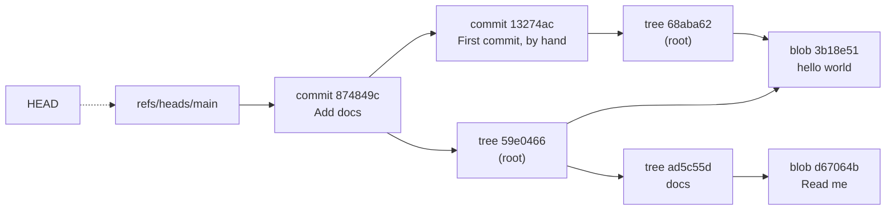
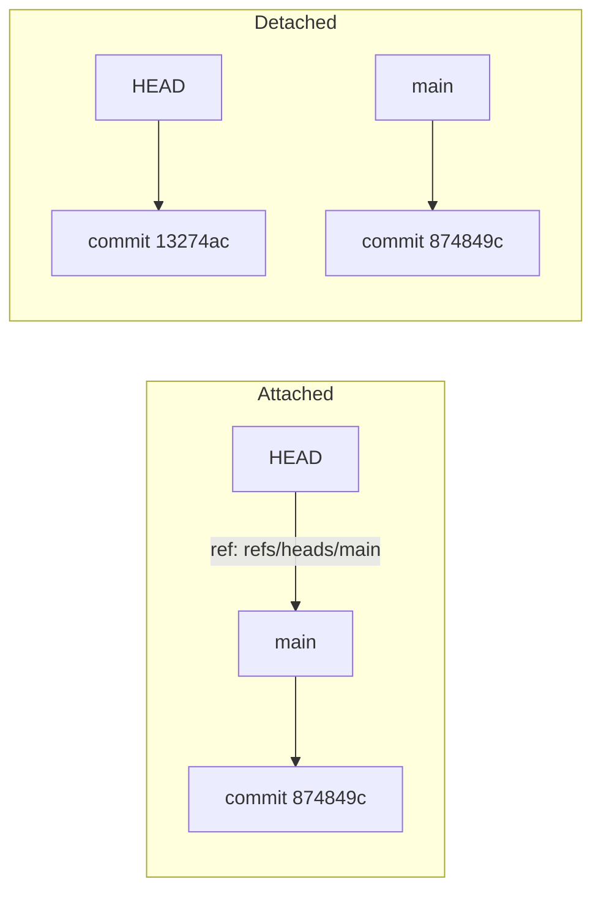
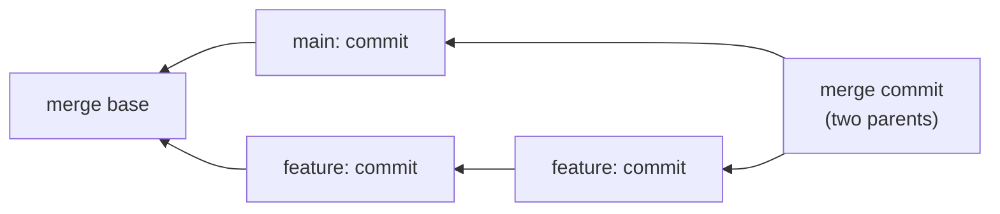
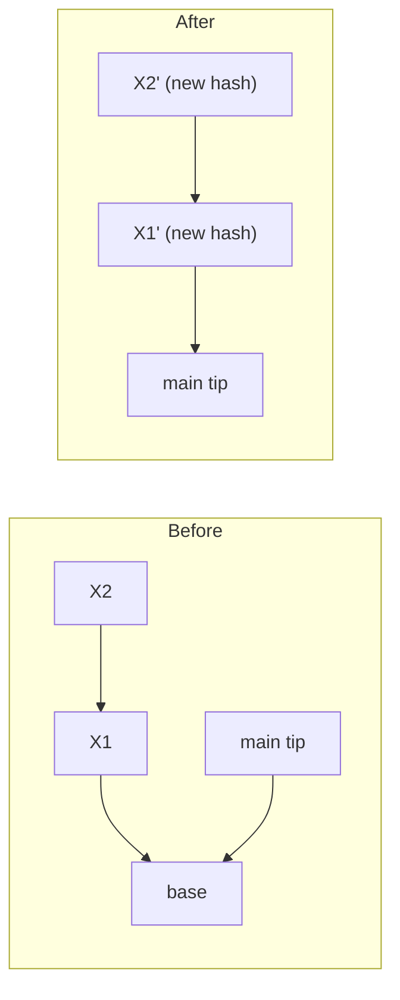

Most of us use Git every day and treat it like a black box. You type `git commit`, something happens, and your work is "saved". You type `git reset --hard`, something else happens, and your last few commits are "gone".

But what's actually going on in there?

The surprising answer is that Git is very simple at its core. Underneath all the commands is a tiny database that stores four kinds of objects, plus a handful of text files that point at them. Once you see that, things like detached HEAD, rebase rewriting hashes, and "recovering" a deleted branch stop being scary.

In this post we'll open up the `.git` directory, build a commit by hand without ever running `git commit`, and then look at how branches, merges, rebases, packfiles and `fetch` really work. If you want the everyday command reference instead, I've covered that in my post on the most commonly used Git commands. This one is about what happens underneath them.

## Git is a key-value store with a version control system on top

Here's the mental model I wish someone had given me earlier. At its heart, Git is a content-addressable key-value store.

"Content-addressable" means the key for each piece of data is computed from the data itself. You give Git some content, Git hashes it, and the hash becomes the key. Same content, same key, on every machine in the world. Different content (even one byte different), different key.

That one design decision explains a lot. Git never stores the same file content twice, because identical content produces the same key. It can tell instantly whether two trees are identical by comparing two hashes. And it can detect corruption, because if the bytes on disk don't hash to their own name, something's wrong.

Everything else (branches, the staging area, merges, remotes) is built on top of that store.

## A look inside .git

Let's start with an empty repo and see what's there:

```bash
$ mkdir demo && cd demo
$ git init -b main
$ ls .git
HEAD  config  description  hooks  info  objects  refs
```

That's it. No database server, no binary blob of mystery. Here's what each piece does, including the ones that appear later:

- `objects/` is the key-value store. Every blob, tree, commit and annotated tag lives here.
- `refs/` holds branches (`refs/heads/`), tags (`refs/tags/`) and remote-tracking branches (`refs/remotes/`). Each one is a tiny text file containing a hash.
- `HEAD` says what you've currently got checked out. Usually it's a pointer to a branch.
- `index` is the staging area. It doesn't exist until you stage something.
- `config` is the repo-level config (remotes, branch tracking, and so on).
- `hooks/` contains sample scripts (`pre-commit.sample` and friends). Drop the `.sample` and make one executable, and Git runs it at that point in the workflow.
- `logs/` holds the reflogs, a history of where each ref has pointed. It shows up after the first ref update.
- `packed-refs` appears after a `git gc` or `git pack-refs`, and stores many refs in one file instead of one file each.

Notice that `objects/` is empty for now. Let's fix that.

## The four object types

Git's object store holds exactly four types of object:

- a blob, which is the contents of a file (just the bytes, no file name, no permissions)
- a tree, which is a directory listing: names, modes, and the hashes of blobs and other trees
- a commit, which points to one tree (the snapshot) plus zero or more parent commits, an author, a committer and a message
- an annotated tag, which points to another object (usually a commit) with a name, a tagger and a message

That's the whole data model. Let's create a blob.

### Hashing a blob

The plumbing command `git hash-object` takes content and tells you its key:

```bash
$ echo 'hello world' | git hash-object --stdin
3b18e512dba79e4c8300dd08aeb37f8e728b8dad
```

Run that on your machine and you'll get exactly the same hash. Every Git user on the planet will.

But where does that number come from? Git doesn't hash just your content. It first prepends a header in the form `type size\0`, meaning the object type, a space, the content length in bytes, and a null byte. Then it hashes the whole thing with SHA-1.

`hello world\n` is 12 bytes, so the thing being hashed is `blob 12\0hello world\n`. We can check that without Git at all:

```bash
$ printf 'blob 12\0hello world\n' | shasum
3b18e512dba79e4c8300dd08aeb37f8e728b8dad  -
```

Same hash. No magic.

Here's the same calculation in Java, if you'd rather see it in code (`HexFormat` needs Java 17 or later):

```java
import java.nio.charset.StandardCharsets;
import java.security.MessageDigest;
import java.util.HexFormat;

public class GitBlobHash {

    static String blobHash(byte[] content) throws Exception {
        byte[] header = ("blob " + content.length + "\0").getBytes(StandardCharsets.US_ASCII);
        MessageDigest sha1 = MessageDigest.getInstance("SHA-1");
        sha1.update(header);   // "blob 12\0"
        sha1.update(content);  // the raw bytes, nothing else
        return HexFormat.of().formatHex(sha1.digest());
    }

    public static void main(String[] args) throws Exception {
        System.out.println(blobHash("hello world\n".getBytes(StandardCharsets.UTF_8)));
        // prints 3b18e512dba79e4c8300dd08aeb37f8e728b8dad
    }
}
```

Note that the size is the length in bytes, not characters. For anything outside ASCII, that difference matters.

### Writing it to disk

`hash-object` only computes the hash unless you pass `-w`, which writes the object into the store:

```bash
$ echo 'hello world' | git hash-object -w --stdin
3b18e512dba79e4c8300dd08aeb37f8e728b8dad

$ find .git/objects -type f
.git/objects/3b/18e512dba79e4c8300dd08aeb37f8e728b8dad
```

The path is the hash split in two: the first two hex characters become a directory, and the remaining 38 become the file name. This is called a loose object. The split keeps any single directory from holding a huge number of files.

The file itself is the header plus content, compressed with zlib. You can decompress it with anything that speaks zlib:

```bash
$ python3 -c "import zlib; print(zlib.decompress(open('.git/objects/3b/18e512dba79e4c8300dd08aeb37f8e728b8dad','rb').read()))"
b'blob 12\x00hello world\n'
```

And Git's own way of reading objects is `git cat-file`. Use `-t` for the type, `-s` for the size, and `-p` to pretty-print the content:

```bash
$ git cat-file -t 3b18e512
blob
$ git cat-file -s 3b18e512
12
$ git cat-file -p 3b18e512
hello world
```

Yes, you can abbreviate hashes, as long as the prefix is unique in the repo.

Notice what's missing from the blob: the file name. A blob doesn't know it's called `hello.txt`. That's the tree's job.

## SHA-1, SHAttered, and SHA-256

Quick but important detour. If everything is keyed by SHA-1, what happens when two different pieces of content produce the same SHA-1?

For a long time that was theoretical. Then in February 2017, researchers from Google and CWI Amsterdam published SHAttered: two different PDF files with the same SHA-1 hash. It was the first practical SHA-1 collision.

Git's response came fast. Since Git 2.13 (2017), Git uses a "hardened" SHA-1 implementation based on the sha1collisiondetection library. It computes normal SHA-1 hashes, so existing repos didn't change, but it detects inputs that look like they're part of a known collision attack (such as the SHAttered technique) and refuses them. So the specific attack doesn't work against Git.

The longer-term fix is moving off SHA-1 entirely. Git has supported SHA-256 repositories since Git 2.29 (2020), originally marked experimental:

```bash
$ git init --object-format=sha256
$ echo 'hello world' | git hash-object --stdin
0bd69098bd9b9cc5934a610ab65da429b525361147faa7b5b922919e9a23143d
```

Longer hashes, same idea. The catch is the ecosystem. Interoperability between SHA-1 and SHA-256 repositories is still limited, and support across hosting services and tools has been patchy, so almost every repo you'll meet in the wild is still SHA-1. The Git project's plans for Git 3.0 include switching the default to SHA-256, but on the Git 2.54 I used for this post, a plain `git init` still gives you SHA-1. You can check any repo with `git rev-parse --show-object-format`.

## Building a commit by hand

Now for the fun part. We're going to create a real commit using only plumbing commands. No `git add`, no `git commit`.

"Plumbing" is Git's name for the low-level commands meant for scripts. The friendly commands you use every day (`add`, `commit`, `checkout`) are called "porcelain", and they're built on top of plumbing.

I set fixed author and committer names and dates through environment variables (`GIT_AUTHOR_DATE`, `GIT_COMMITTER_DATE` and friends) so the commit hashes below are reproducible. If you run this without them, your blob and tree hashes will match mine, but your commit hashes won't, because a commit includes the author, the committer and their timestamps.

### Step 1: stage the blob

We already have our blob. Now we tell the index that a file called `hello.txt` should contain it:

```bash
$ git update-index --add --cacheinfo 100644,3b18e512dba79e4c8300dd08aeb37f8e728b8dad,hello.txt

$ git ls-files --stage
100644 3b18e512dba79e4c8300dd08aeb37f8e728b8dad 0	hello.txt
```

Read that line as mode, blob hash, stage number, path. `100644` is a normal non-executable file. The `0` is the stage number, which only becomes interesting during merge conflicts (more on that later).

Notice that `hello.txt` doesn't exist in the working directory at all. The index doesn't care. It's just a list.

### Step 2: turn the index into a tree

```bash
$ git write-tree
68aba62e560c0ebc3396e8ae9335232cd93a3f60

$ git cat-file -p 68aba62e
100644 blob 3b18e512dba79e4c8300dd08aeb37f8e728b8dad	hello.txt
```

`write-tree` takes whatever is in the index and writes tree objects for it. A tree entry is a mode, a type, a hash and a name. The modes you'll see are `100644` (regular file), `100755` (executable), `120000` (symlink), `040000` (subdirectory, which points at another tree) and `160000` (a submodule commit).

`git ls-tree 68aba62e` gives you the same listing, and it's handy for scripts.

### Step 3: wrap the tree in a commit

```bash
$ echo "First commit, by hand" | git commit-tree 68aba62e
13274ac8229cef8b39a382a5aafb6d9f0023607c

$ git cat-file -p 13274ac8
tree 68aba62e560c0ebc3396e8ae9335232cd93a3f60
author Pratik Chaudhari <pratik@example.com> 1793421000 +0530
committer Pratik Chaudhari <pratik@example.com> 1793421000 +0530

First commit, by hand
```

That's a commit, in its entirety. Plain text. A tree, an author and a committer (each with a Unix timestamp and time zone), a blank line, and the message. This one has no `parent` line because it's the first commit.

Why are there both an author and a committer? The author wrote the change; the committer applied it. They differ when you cherry-pick or rebase someone else's work, or apply a patch from an email.

### Step 4: point a branch at it

Right now our commit exists, but nothing points to it. `git log` would tell you there are no commits yet. Let's fix that:

```bash
$ git update-ref -m "commit (by hand): First commit, by hand" refs/heads/main 13274ac8

$ cat .git/refs/heads/main
13274ac8229cef8b39a382a5aafb6d9f0023607c

$ cat .git/HEAD
ref: refs/heads/main

$ git log --oneline
13274ac First commit, by hand
```

And that's a commit. `git status` will complain that `hello.txt` is deleted, because it's in the commit and the index but not on disk, and `git restore hello.txt` writes it out from the blob.

### A second commit with a subdirectory

Let's add a directory so we can see trees nesting. This time I'll let `update-index` hash the file for us:

```bash
$ mkdir docs && printf 'Read me\n' > docs/README.md
$ git update-index --add docs/README.md

$ git ls-files --stage
100644 d67064b5343698146a1d22c063f80b039020314a 0	docs/README.md
100644 3b18e512dba79e4c8300dd08aeb37f8e728b8dad 0	hello.txt

$ git write-tree
59e046697edd87e206dba59a0717e264b378c2f1

$ git cat-file -p 59e04669
040000 tree ad5c55d4d6f9dcc0606c10e45ca6c3edb96cf26d	docs
100644 blob 3b18e512dba79e4c8300dd08aeb37f8e728b8dad	hello.txt
```

The root tree now points to a subtree for `docs`. And look at `hello.txt`: same blob hash as before. Git didn't store it again. Unchanged files are just pointers to objects that already exist.

Now the commit, with `-p` to set the parent:

```bash
$ echo "Add docs" | git commit-tree 59e04669 -p 13274ac8
874849cbd2e23b37dbf16e1731f2f98a398d2f64

$ git cat-file -p 874849cb
tree 59e046697edd87e206dba59a0717e264b378c2f1
parent 13274ac8229cef8b39a382a5aafb6d9f0023607c
author Pratik Chaudhari <pratik@example.com> 1793421300 +0530
committer Pratik Chaudhari <pratik@example.com> 1793421300 +0530

Add docs

$ git update-ref -m "commit (by hand): Add docs" refs/heads/main 874849cb 13274ac8
```

That last argument to `update-ref` is the old value. Git only updates the ref if it still points there, which is a neat little safety check against races.

Here's the object graph we just built:



Two commits, three trees, two blobs, with `hello.txt` shared by both snapshots.

This is also why a commit hash "covers the whole history". It depends on its tree (and so on every blob and subtree) and on its parent's hash, which depends on *its* parent, and so on. Change one byte anywhere and every later hash changes.

## Snapshots, not diffs

Look at that graph again. Each commit points to a complete tree, a full snapshot of the project at that moment. Commits don't store "what changed".

So when you run `git diff` or `git show`, Git computes the diff on the fly by comparing two trees. Since unchanged subtrees have identical hashes, it can skip whole directories without looking inside them, which is why diffs are fast even in huge repos.

"Doesn't storing full snapshots waste a ton of space?" Conceptually, it would. In practice, unchanged content is shared (as we just saw), and packfiles store similar objects as deltas. We'll get there.

## Annotated tags

A lightweight tag is just a ref, a file under `refs/tags/` with a commit hash in it. An annotated tag is a real object:

```bash
$ git tag -a v1.0 -m "First release"

$ git cat-file -t v1.0
tag

$ git cat-file -p v1.0
object 874849cbd2e23b37dbf16e1731f2f98a398d2f64
type commit
tag v1.0
tagger Pratik Chaudhari <pratik@example.com> 1793421000 +0530

First release

$ cat .git/refs/tags/v1.0
9a8a1b137bb3f236d676ccf901b29a940434b482
```

So the ref `refs/tags/v1.0` points to the tag object (`9a8a1b1`), and the tag object points to the commit. That extra object is where the tagger, the date, the message and an optional GPG signature live. For releases, use annotated tags.

## The index, a.k.a. the staging area

We've been using the index as "a list of files to commit", and that's mostly right. But it's worth knowing what's really in `.git/index`.

It's a binary file that starts with the signature `DIRC` (short for "dircache", the index's original name) and a version number. Then there's one entry per tracked file, sorted by path. `git ls-files --stage --debug` shows you a decoded entry:

```bash
$ git ls-files --stage --debug
100644 3b18e512dba79e4c8300dd08aeb37f8e728b8dad 0	hello.txt
  ctime: 1793464674:528485304
  mtime: 1793464674:528485304
  dev: 16777230	ino: 38790322
  uid: 501	gid: 0
  size: 12	flags: 0
```

So each entry has the mode, the blob hash, the stage number and the path, and also a bunch of filesystem metadata: change time, modification time, device, inode, owner and size. (Your numbers will differ; these depend on your filesystem and the moment you ran it.)

Why store all that? Speed. This is the stat cache. When you run `git status`, Git doesn't re-hash every file in your project. It calls `stat()` on each file and compares the result to what's in the index. If the size and timestamps match, Git assumes the file hasn't changed and moves on. Only files whose metadata changed get re-read and re-hashed. On a big repo, that's the difference between instant and painfully slow.

(There's a subtle edge case called "racy git", where a file changed in the same timestamp tick as the index was written looks unchanged. Git re-checks the content of entries like that.)

The index is also how Git does three-way merges. During a conflict, a single path can have up to three entries: stage 1 (the common ancestor's version), stage 2 ("ours") and stage 3 ("theirs"). That's what `git ls-files --stage` shows you mid-conflict, and resolving the conflict means replacing those with a single stage 0 entry, which is exactly what `git add` does.

So the three places your file can be are the working directory (files on disk), the index (what the next commit's tree will look like) and HEAD (the tree of the last commit). `git status` is really two comparisons: HEAD vs index ("changes to be committed") and index vs working directory ("changes not staged").

## Refs, HEAD and friends

A branch is a file with a hash in it. That's it.

```bash
$ cat .git/refs/heads/main
874849cbd2e23b37dbf16e1731f2f98a398d2f64
```

Creating a branch writes a new 41-byte file. Deleting one removes it. This is why branches in Git are so cheap compared to older systems that copied directories around.

HEAD is usually a symbolic ref, a ref that points to another ref instead of to a hash:

```bash
$ cat .git/HEAD
ref: refs/heads/main

$ git symbolic-ref HEAD
refs/heads/main
```

When you commit, Git creates the commit object with the current HEAD commit as its parent, then updates whichever branch HEAD points to. HEAD itself doesn't change; the branch moves underneath it.

### Detached HEAD

If you check out a specific commit instead of a branch, HEAD stops pointing at a ref and holds the hash directly:

```bash
$ git checkout 13274ac
$ cat .git/HEAD
13274ac8229cef8b39a382a5aafb6d9f0023607c
```

That's "detached HEAD". Nothing is broken. It just means new commits you make won't move any branch, so once you switch away, nothing points to them anymore. They're not deleted (yet), just unreachable. If you want to keep them, create a branch right there with `git switch -c my-branch`.



### rev-parse: turning names into hashes

Whenever you type `HEAD~1`, `main^{tree}` or `v1.0`, something has to turn that name into a hash. That something is `git rev-parse`:

```bash
$ git rev-parse HEAD
874849cbd2e23b37dbf16e1731f2f98a398d2f64
$ git rev-parse --short HEAD
874849c
$ git rev-parse HEAD~1
13274ac8229cef8b39a382a5aafb6d9f0023607c
$ git rev-parse HEAD^{tree}
59e046697edd87e206dba59a0717e264b378c2f1
```

`HEAD~1` means "first parent of HEAD". `^{tree}` means "peel this down to its tree". Most porcelain commands quietly call the same name-resolution logic.

### Remote-tracking refs and packed-refs

`refs/remotes/origin/main` is your local copy of where `main` was on `origin` the last time you talked to it. You don't commit to it; `git fetch` updates it. When `git status` says you're "ahead by 2", it's comparing `refs/heads/main` against `refs/remotes/origin/main`, both of which are local. No network involved.

Big repos can have thousands of tags and remote branches, and thousands of tiny files is slow. So `git gc` (or `git pack-refs`) moves them into a single `.git/packed-refs` file:

```bash
$ cat .git/packed-refs
# pack-refs with: peeled fully-peeled sorted
874849cbd2e23b37dbf16e1731f2f98a398d2f64 refs/heads/main
9a8a1b137bb3f236d676ccf901b29a940434b482 refs/tags/v1.0
^874849cbd2e23b37dbf16e1731f2f98a398d2f64
```

The `^` line is the "peeled" value of the annotated tag above it, meaning the commit it finally points to, cached so Git doesn't have to open the tag object. A loose ref file, if one exists, wins over the packed entry. So don't go hunting in `refs/heads/` and assume a branch doesn't exist; use `git show-ref` or `git for-each-ref`. (Newer Git versions also offer an alternative ref storage format called reftable, via `git init --ref-format=reftable`, which replaces both of these with a binary format.)

### The reflog

Every time a ref moves, Git appends a line to its log in `.git/logs/`. That's the reflog:

```bash
$ git reflog
13274ac HEAD@{0}: reset: moving to HEAD~1
874849c HEAD@{1}: commit (by hand): Add docs
13274ac HEAD@{2}: commit (by hand): First commit, by hand
```

Here I've just done `git reset --hard HEAD~1`, which moved `main` back one commit. `git log` now only shows the first commit. "Add docs" looks gone.

It isn't. It's still in the object store, and the reflog remembers it as `HEAD@{1}`:

```bash
$ git branch rescue HEAD@{1}
$ git log --oneline rescue
874849c Add docs
13274ac First commit, by hand
```

Back from the dead. Just remember the reflog is local; it's never pushed or cloned.

## What the porcelain commands actually do

With objects, the index and refs in your head, the everyday commands become almost boring.

`git add file` hashes the file into a blob (writing it into `objects/`) and updates the file's entry in the index. That's why staged content survives even if you then edit the file again: the blob is already stored.

`git commit` is `write-tree`, then `commit-tree` with HEAD as the parent, then `update-ref` on the current branch, with a reflog entry. We just did all three by hand.

`git checkout <branch>` or `git switch <branch>` (the clearer command added in Git 2.23) reads the target commit's tree, updates the index and working directory to match, and then points HEAD at the new branch. Files that are the same in both trees aren't touched.

### Merge

When you merge `feature` into `main`, Git first finds the merge base: the best common ancestor of the two commits. `git merge-base main feature` will show it to you.

If `main` *is* the merge base (nothing has happened on `main` since `feature` branched off), there's nothing to combine. Git just moves `main` forward to `feature`'s commit. That's a fast-forward, and no new commit is created.

Otherwise, Git does a three-way merge. It compares the merge base with each side, takes changes that only one side made, and flags places where both sides changed the same lines as conflicts (those are the stage 1/2/3 index entries from earlier). If everything resolves, Git writes a new tree and a merge commit with two `parent` lines.



The algorithm that does this is the merge strategy. Since Git 2.34 (2021), the default has been `ort` ("Ostensibly Recursive's Twin"), a rewrite of the older `recursive` strategy that's much faster and handles renames better. If the two branches have more than one best common ancestor, it merges those ancestors first to build a virtual merge base.

### Rebase and cherry-pick

Why does rebase change commit hashes? This trips up a lot of people.

Because it has to. A commit's hash includes its parent's hash. If you move commit X so it sits on top of a different parent, X with a new parent is a different object with a different hash. There's no way to "move" a commit in Git. You can only create new ones.

So `git rebase main` on a feature branch roughly does this: find the commits on your branch that aren't on `main`, then replay each one on top of `main`, creating a new commit with the same changes, author and message but a new parent (and a new committer timestamp). Then it moves your branch ref to the last new commit. The old commits are still in the object store, unreferenced except by the reflog, and Git also saves where you were in `ORIG_HEAD`.



That's why rebasing already-pushed commits annoys your teammates: their copies still have the old ones.

`git cherry-pick <commit>` is a single replay. Internally it's a three-way merge where the base is the picked commit's parent, "theirs" is the picked commit and "ours" is HEAD. The result is a new commit on your branch with the original author but you as the committer.

## Packfiles and delta compression

Loose objects are simple, but one zlib-compressed file per object adds up. A big repo would have millions of them, and full copies of every version of every file.

So Git periodically packs objects. `git gc` (which also runs automatically now and then, via `git gc --auto` after certain commands) gathers loose objects into a packfile:

```bash
$ git count-objects -v
count: 8
...
in-pack: 0

$ git gc

$ git count-objects -v
count: 0
...
in-pack: 8

$ ls .git/objects/pack
pack-955c2318170eb0be3d4b722f0aa84116be9829bc.idx
pack-955c2318170eb0be3d4b722f0aa84116be9829bc.pack
pack-955c2318170eb0be3d4b722f0aa84116be9829bc.rev
```

The `.pack` file holds the objects themselves, one after another. The `.idx` file is a sorted index from object hash to offset in the pack, so Git can binary-search for any object without scanning the pack. Recent Git versions also write a `.rev` reverse index, which maps the other way (pack position to object).

Inside a pack, Git can store an object as a delta: "take that other object and apply these changes". The clever part is that Git doesn't delta against "the previous commit's version". It looks for any similar object (it sorts candidates by type, file name and size, then tries deltas within a sliding window) and picks whatever gives a small result. Typically, recent versions are stored in full and older versions as deltas, because recent ones get read most.

You can see what's in a pack with `git verify-pack`:

```bash
$ git verify-pack -v .git/objects/pack/pack-955c23...idx
874849cbd2e23b37dbf16e1731f2f98a398d2f64 commit 231 155 12
9a8a1b137bb3f236d676ccf901b29a940434b482 tag    146 137 167
13274ac8229cef8b39a382a5aafb6d9f0023607c commit 196 132 304
59e046697edd87e206dba59a0717e264b378c2f1 tree   68 79 436
...
non delta: 8 objects
```

The columns are hash, type, size, size in the pack and offset. Our toy repo is too small for any deltas. In a real repo, you'd see extra columns with the delta chain depth and the base object.

And that's the answer to the snapshot question. Conceptually, every commit is a full snapshot. Physically, packfiles make it compact. The diff-based storage is an implementation detail that you never see through the object model.

## Garbage collection and unreachable objects

An object is reachable if you can get to it by starting from some ref (a branch, a tag, HEAD, a reflog entry, the stash) and following pointers: commit to tree, tree to blob, commit to parent. Anything else is unreachable.

Unreachable objects pile up naturally. A rebase leaves the old commits behind. A `reset --hard` abandons commits. Staging a file, editing it and staging it again leaves the first blob with nothing pointing at it.

`git gc` cleans this up, but carefully:

- Reflog entries expire. By default, entries for commits still reachable from the ref are kept for 90 days (`gc.reflogExpire`), and entries for commits that aren't are kept for 30 days (`gc.reflogExpireUnreachable`).
- Once no reflog entry references an object, it becomes truly unreachable. Even then, `git gc` only prunes loose unreachable objects older than two weeks by default (`gc.pruneExpire`).

So you've got a generous safety net. If you "lost" a commit, first look in `git reflog`, or `git reflog show <branch>` for one branch. If the reflog doesn't have it (for example, a dropped stash), `git fsck --lost-found` lists dangling commits and blobs that are still in the object store. `git cat-file -p` lets you inspect each one, and `git branch rescue <hash>` brings it back.

The flip side: a committed secret doesn't vanish when you delete the branch. It's in the object store until it's pruned, and in every clone that fetched it. Rotate the secret.

## How fetch and push work

Remotes are just other repositories with the same object model. Syncing is about two things: getting objects you don't have, and updating refs.

### Refspecs

When you clone, Git writes something like this into `.git/config`:

```ini
[remote "origin"]
    url = https://github.com/someone/project.git
    fetch = +refs/heads/*:refs/remotes/origin/*
```

That `fetch` line is a refspec. Read it as "take every ref under `refs/heads/` on the remote and store it locally under `refs/remotes/origin/`". The `+` means "update even if it isn't a fast-forward", which is what you want for remote-tracking refs, because someone might have force-pushed.

Push uses refspecs too: `git push origin main` is short for `refs/heads/main:refs/heads/main`.

### Negotiation and packs

A fetch goes roughly like this. Your client asks the server which refs it has. The client says which commits it "wants" (the remote tips it doesn't have) and which commits it "has" (its own recent commits). The server uses the "haves" to find common history, then builds a packfile containing only the objects you're missing, often with deltas against objects it knows you already have. Your Git stores the pack, then updates `refs/remotes/origin/*` and writes `FETCH_HEAD`.

Push is the same dance in the other direction. Your client works out what the server lacks, sends a pack, and asks it to update refs. By default the server refuses a ref update that isn't a fast-forward, which is the "rejected, non-fast-forward" error you've definitely seen. `--force` (or a `+` in the refspec) overrides that; `--force-with-lease` overrides it only if the remote ref is still where you last saw it.

### Protocol v2

Git's wire protocol v2 arrived in Git 2.18 (2018) and became the default in Git 2.26 (2020). The biggest practical change is that the server no longer dumps its entire list of refs at the start of every fetch. The client asks for the refs it cares about. On repos with huge numbers of refs (think thousands of tags or pull-request refs), that alone makes fetches noticeably cheaper.

## Takeaways

Git's core is a content-addressed store of blobs, trees, commits and annotated tags, each keyed by the SHA-1 (or SHA-256) of `type size\0` plus its content.

Branches, tags and HEAD are tiny text files pointing at hashes. Detached HEAD only means HEAD holds a hash instead of a branch name.

The index is a binary list of paths and blob hashes, plus the stat cache that keeps `git status` fast. Merge conflicts live there too.

Commits are snapshots. Diffs are computed when you ask for them, and packfiles with delta compression keep it all small on disk.

Rebase and cherry-pick create new commits with new hashes, because a commit's hash covers its parent.

And Git almost never throws your work away immediately. Between the reflog and the gc grace periods, a "lost" commit is usually one `git reflog` away. Next time Git scares you, open `.git` and have a look. It's just files.
