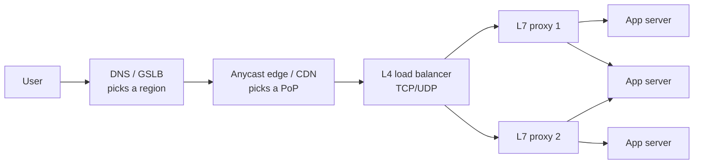
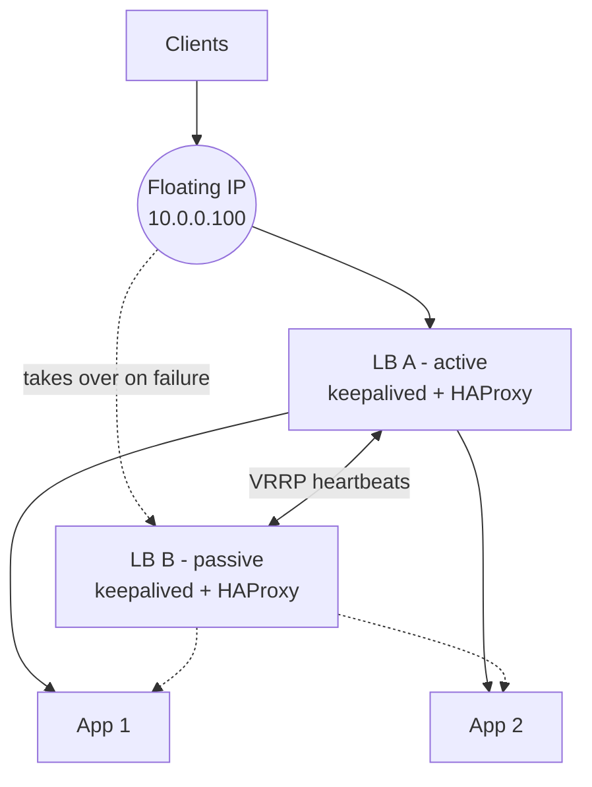

**Load balancing** distributes network traffic across a group of servers or service instances. A load balancer selects a destination for each connection or request, excludes unhealthy destinations, and provides a stable entry point while the backend pool changes. Its decisions affect capacity, availability, and response time.

Load distribution developed alongside the growth of networked services. DNS rotation provided an early way to spread clients across addresses. During the 1990s, dedicated switches and software proxies made traffic distribution a separate infrastructure function. Later designs added application-aware routing, global traffic management, and distributed software data planes. Google's Maglev, described in 2016, is one example of this progression towards large-scale software load balancing.

Today load balancing occurs in DNS services, CDNs, cloud platforms, Kubernetes networking, service proxies, and client libraries. These mechanisms operate at different layers and make different trade-offs. This article covers where they sit, how their selection algorithms work, and how health checks, failover, retries, and operational settings affect the result.

## Why Load Balancing Exists

Three requirements explain its role:

- **Horizontal scaling**: when one machine cannot handle the workload, traffic must be distributed across multiple instances. Scaling vertically has capacity and cost limits; adding instances requires a selection mechanism.
- **Availability**: hardware failures, process crashes, and faulty releases should not keep receiving new traffic. A load balancer can remove unhealthy instances while healthy ones continue serving requests, provided sufficient capacity remains.
- **Controlled deployment**: instances can leave rotation, finish in-flight work, receive an update, and return. Rolling deployments, blue-green releases, and canaries use traffic management to control exposure rather than interrupt the entire service.

## Where Load Balancing Happens

Load balancing can occur at several layers. A request may pass through DNS selection, an edge network, an infrastructure balancer, and an application proxy before reaching a service instance.



### DNS-Level Balancing

**DNS-level balancing** returns different addresses for the same name. Round-robin DNS rotates address records; policy-aware DNS can select a region using health, latency, or geography. This is often part of **global server load balancing**, or GSLB.

DNS distribution scales widely but is coarse-grained. Resolvers and clients cache answers for a TTL, sometimes longer. Plain record rotation has no knowledge of live backend load, although managed DNS policies can incorporate health and other signals.

### Edge Networks and CDNs

**CDNs and edge networks**, including Cloudflare, Fastly, and CloudFront, direct users to a point of presence and can distribute traffic across origins. Anycast is one common routing mechanism. For many web applications, the CDN is the first traffic-distribution layer.

### L4 vs L7

The distinction between **L4** and **L7** comes from the transport and application layers of the OSI model. It determines what information a balancer can use.

An **L4 load balancer** uses transport information such as IP addresses, ports, and protocol. For TCP, it selects a backend for a connection and keeps packets associated with that selection. UDP uses flow mappings rather than TCP connections. Ordinary L4 selection does not inspect HTTP URLs, headers, or cookies.

This keeps L4 processing relatively lightweight and independent of application syntax. It can distribute PostgreSQL, Redis, MQTT, and other TCP or UDP traffic, provided backend semantics permit that distribution.

An **L7 load balancer** understands an application protocol, usually HTTP. A reverse proxy terminates the client connection, reads requests, and opens or reuses backend connections. Application visibility enables it to:

- route `/api/*` to one pool and `/static/*` to another
- route by host name, header or cookie
- balance per request instead of per connection
- retry a failed request on another backend
- add headers like `X-Forwarded-For`, rewrite paths, compress responses, enforce rate limits

Application processing adds CPU and connection-management work. Backends may see the proxy's address rather than the original client. `X-Forwarded-For` can carry that information for HTTP; the **PROXY protocol** can carry connection metadata when supported. Accept forwarded identity only from trusted proxies, since clients can supply forged headers.

The unit of selection matters for **HTTP/2 and gRPC**. Many requests can share one long-lived connection. An L4 balancer normally assigns that connection once, so a busy client can concentrate traffic on one backend even when others have capacity. Per-request L7 balancing or client-side balancing can distribute that work more evenly.

| Property | L4 | L7 |
|---|---|---|
| Selection unit | Connection or flow | Application request, where supported |
| Routing information | Addresses, ports, protocol | Host, path, headers, cookies |
| Encrypted HTTP visibility | No ordinary payload inspection | Requires TLS termination |
| Typical use | General TCP/UDP distribution | HTTP routing and request policies |

### TLS Termination vs Passthrough

TLS placement determines which component can inspect encrypted requests.

With **TLS termination**, the proxy holds certificate credentials and decrypts traffic. This enables HTTP inspection, centralizes certificate management, and moves client handshake work away from application servers. Backend traffic is plaintext unless a separate TLS connection is established. Credentials and decrypted traffic make the proxy a sensitive security boundary.

With **TLS passthrough**, the backend terminates TLS and the balancer forwards encrypted traffic without holding the backend's private key. It cannot route using decrypted HTTP fields. Some passthrough proxies inspect the ClientHello **SNI** hostname for routing, but encrypted ClientHello can hide that information.

A common design terminates TLS at an L7 proxy and encrypts the backend hop where the trust model or policy requires it. Passthrough is appropriate when the backend must own the TLS session, including some end-to-end authentication arrangements.

### Client-Side Load Balancing

Sometimes there's no load balancer box at all. The client gets a list of backend addresses (from DNS, a service registry like Consul or Eureka, or Kubernetes) and picks one itself. gRPC has this built in, Spring Cloud LoadBalancer does it for Spring apps, and Netflix's Ribbon was the classic example before it went into maintenance mode.

Client-side selection removes a proxy hop but distributes discovery and health logic across clients, each with its own view of the pool. Service meshes can place this logic in infrastructure proxies instead of application libraries. Istio uses Envoy in its sidecar model; other deployment models and Linkerd's own proxy differ.

## Selection Algorithms

The following algorithms illustrate different selection policies. The Java examples assume a non-empty backend list and omit health filtering, dynamic discovery, and full lifecycle management. Production selection must account for those concerns as well as concurrency and valid weights.

### Round Robin

**Round robin** cycles through the backend list. It is nginx's default upstream policy and works well when backend capacities and request costs are similar.

```java
class RoundRobin {
    private final List<String> servers;
    private final AtomicInteger next = new AtomicInteger();

    RoundRobin(List<String> servers) { this.servers = List.copyOf(servers); }

    String pick() {
        // floorMod keeps it non-negative after the counter overflows
        return servers.get(Math.floorMod(next.getAndIncrement(), servers.size()));
    }
}
```

The policy balances selection counts, not work. A profile lookup and a lengthy PDF-generation request each receive one turn despite their different resource costs.

### Smooth Weighted Round Robin

**Weighted round robin** assigns larger shares to more capable backends. A naive schedule can group selections into bursts, such as `(a, a, a, a, a, b, c)`. nginx's **smooth weighted round robin** interleaves them by accumulating each server's weight:

```java
class SmoothWeighted {
    static final class Node {
        final String name; final int weight; int current;
        Node(String name, int weight) { this.name = name; this.weight = weight; }
    }

    private final List<Node> nodes = new ArrayList<>();
    private final int total;

    SmoothWeighted(Map<String, Integer> weights) {
        weights.forEach((n, w) -> nodes.add(new Node(n, w)));
        total = nodes.stream().mapToInt(n -> n.weight).sum();
    }

    synchronized String pick() {
        Node best = null;
        for (Node n : nodes) {
            n.current += n.weight;                       // everyone earns their weight
            if (best == null || n.current > best.current) best = n;
        }
        best.current -= total;                           // the winner pays the total back
        return best.name;
    }
}
```

With weights a=5, b=1, c=1, seven picks give:

```text
a a b a c a a
```

The ratio remains 5:1:1, but smaller backends receive turns throughout the cycle. Tie-breaking depends on iteration order, so use a predictable order when an exact sequence matters.

### Least Connections

**Least connections** selects the server with the fewest active connections. Slower operations retain connections longer, which can reduce the rate of new selections for that backend.

```java
class LeastConnections {
    private final Map<String, AtomicInteger> active = new LinkedHashMap<>();

    LeastConnections(List<String> servers) {
        servers.forEach(s -> active.put(s, new AtomicInteger()));
    }

    String acquire() {
        String best = Collections.min(active.keySet(),
                Comparator.comparingInt(s -> active.get(s).get()));
        active.get(best).incrementAndGet();
        return best;
    }

    void release(String server) { active.get(server).decrementAndGet(); } // call when the request finishes
}
```

Selection and increment are not atomic in this example. Concurrent callers can choose the same backend. An implementation can synchronize selection or accept an approximate least-loaded choice, depending on its consistency and throughput requirements.

This policy is useful when connection durations vary. nginx exposes `least_conn`, and HAProxy exposes `balance leastconn`. AWS ALB offers **least outstanding requests**, which counts requests rather than connections and is therefore a related but different load signal.

### Least Response Time

**Least response time** uses observed latency to favor responsive backends. An **exponentially weighted moving average**, or EWMA, weights recent samples more heavily than older ones:

```java
class LeastResponseTime {
    private static final double ALPHA = 0.3; // how much the newest sample counts
    private final Map<String, Double> ewmaMillis = new HashMap<>();

    LeastResponseTime(List<String> servers) { servers.forEach(s -> ewmaMillis.put(s, 0.0)); }

    synchronized String pick() {
        return Collections.min(ewmaMillis.entrySet(), Map.Entry.comparingByValue()).getKey();
    }

    synchronized void record(String server, double millis) {
        ewmaMillis.merge(server, millis, (old, now) -> ALPHA * now + (1 - ALPHA) * old);
    }
}
```

Latency alone is an unsafe health signal: a backend returning immediate errors can appear preferable to a healthy backend doing useful work. Practical policies combine latency with errors, active work, and exploration so idle or recovered servers receive fresh observations.

### Random Selection and the Power of Two Choices

**Random selection** needs no shared scheduling state and works across independent balancer instances. Its distribution converges over many selections, but short-term imbalance remains possible.

The **power of two choices**, or P2C, samples two candidates and selects the one with less active work:

```java
String pick() {
    var rnd = ThreadLocalRandom.current();
    String a = servers.get(rnd.nextInt(servers.size()));
    String b = servers.get(rnd.nextInt(servers.size()));
    return active.get(a).get() <= active.get(b).get() ? a : b;
}
```

The approach is supported by research on randomized allocation, including Michael Mitzenmacher's work. Random sampling also reduces synchronized choices: independent balancers observing the same least-loaded backend need not all select it at once.

In the example, sampling is with replacement. With one busy backend and two equally idle backends, the busy one wins only when sampled twice: probability `1/9`. Each idle backend receives probability `4/9`, assuming fixed counters. This illustrates selection bias, not a changing queue simulation. Envoy's equal-weight `LEAST_REQUEST` behavior defaults to two choices, and nginx supports `random two least_conn`.

### IP Hashing and Affinity

**IP hashing** maps a client address deterministically to a backend while the pool remains unchanged:

```java
static String ipHash(String clientIp, List<String> servers) {
    return servers.get(Math.floorMod(clientIp.hashCode(), servers.size()));
}
```

This can preserve affinity, but many clients behind a NAT share one address and therefore one destination. Plain modulo also remaps many keys when the pool size changes. For uniformly distributed non-negative hashes, changing from three to four ordered buckets retains the same bucket for about one quarter of keys and moves about three quarters. **Consistent hashing** reduces this disruption.

### Consistent Hashing with Virtual Nodes

Consistent hashing (from a 1997 paper by Karger and colleagues) puts both servers and keys on a ring of hash values. A key goes to the first server clockwise from its hash. Add a server, and only the keys between it and its neighbour move. Remove one, and only its keys move to the next server.

One ring point per server can produce uneven ownership. **Virtual nodes** assign multiple points to each server, smoothing the distribution:

```java
class ConsistentHashRing {
    private final TreeMap<Long, String> ring = new TreeMap<>();
    private final int vnodes;

    ConsistentHashRing(int vnodes) { this.vnodes = vnodes; }

    void add(String server) {
        for (int i = 0; i < vnodes; i++) ring.put(hash(server + "#" + i), server);
    }

    void remove(String server) {
        for (int i = 0; i < vnodes; i++) ring.remove(hash(server + "#" + i));
    }

    String route(String key) {
        var entry = ring.ceilingEntry(hash(key));                       // first vnode clockwise
        return (entry != null ? entry : ring.firstEntry()).getValue();  // wrap around the ring
    }

    private static long hash(String s) {
        try {
            byte[] d = MessageDigest.getInstance("MD5").digest(s.getBytes(StandardCharsets.UTF_8));
            long h = 0;
            for (int i = 0; i < 8; i++) h = (h << 8) | (d[i] & 0xff); // first 8 bytes as a long
            return h;
        } catch (NoSuchAlgorithmException e) {
            throw new IllegalStateException(e);
        }
    }
}
```

MD5 is used here to obtain a deterministic hash distribution, not as a security guarantee. Non-cryptographic hashes such as MurmurHash or xxHash are common alternatives. The example uses signed `long` ordering consistently throughout the ring.

For equally weighted servers and uniform hashing, adding a fourth server to three has an ideal expected reassignment fraction near one quarter. A finite ring will deviate from that expectation. More virtual nodes generally reduce ownership variance, while adding metadata and update work.

Uses include cache affinity, sharded storage, and L7 routing by user ID or cache key. nginx exposes `hash $request_uri consistent`, and Envoy offers `RING_HASH`.

### Maglev

Maglev is Google's software network load balancer, described in a 2016 paper. Its hashing scheme builds a fixed-size lookup table (the paper uses a prime size like 65,537) where each backend fills slots according to its own permutation. Lookup is a single array index, so it's very fast, the load spreads almost perfectly evenly, and when a backend changes, only a small fraction of entries move. It trades a little more disruption than a ring hash for much better balance and speed. Envoy supports it as the `MAGLEV` policy, and Google Cloud's network load balancing is built on Maglev.

## Health Checks, Outlier Detection and Draining

Selection requires a valid eligible backend set. A three-server round-robin schedule continues sending one third of selections to a failed server until health logic excludes it.

Active health checks are the LB poking each backend on a schedule: "GET /healthz every 2 seconds, mark it down after 3 failures, back up after 2 successes". They catch dead servers even when there's no traffic.

Passive health checks watch real traffic instead. If requests to a server keep failing or timing out, take it out for a while. Open-source nginx does this with `max_fails` and `fail_timeout`. Envoy calls its more advanced version outlier detection: eject a host after N consecutive 5xx responses, or when its success rate is much worse than the rest of the pool, for an ejection time that grows each time it happens again. Envoy also limits the fraction of hosts eligible for ejection, reducing the risk that an overly sensitive policy removes the entire pool.

**Active and passive checks** complement each other. A synthetic endpoint can succeed even when actual requests fail.

A readiness endpoint should indicate whether the instance can serve traffic. Probing every downstream dependency can create correlated failure: a slow shared database marks every application instance unhealthy. Kubernetes distinguishes **liveness**, which can trigger a restart, from **readiness**, which controls traffic eligibility. These need different failure criteria.

**Connection draining**, called deregistration delay in AWS, stops new assignments while allowing in-flight work to finish within a deadline. Without a coordinated drain, removing an instance can interrupt active requests.

**Slow start** handles the reverse transition. A new instance may have cold runtime paths, caches, and connection pools. Gradually increasing its share, for example over 30 seconds, gives those resources time to warm up. HAProxy has `slowstart`, NGINX Plus has `slow_start`, and AWS ALB target groups have a slow start duration.

## Sessions and Stateless Application Instances

Sticky sessions (session persistence) mean "this user always goes to the same server". Usually it's done with a cookie the LB sets, or with IP hash.

Affinity is often introduced for in-memory sessions, shopping carts, or uploads. It couples users to individual instances: failure can lose local state, busy users cannot move freely, and maintenance must account for long sessions.

**Stateless application instances** provide more scheduling freedom. Sessions can live in Redis or a database, with Spring Session providing integration for Spring applications. Signed tokens such as JWTs can carry selected claims with the request, although revocation and authorization state still require deliberate design.

Stickiness still has real uses: WebSockets are tied to one server anyway, and cache-affinity setups route the same key to the same node on purpose.

## Products and Deployment Models

Load balancers are available as hardware appliances, software proxies, and managed services. F5 BIG-IP is one appliance-oriented product family; HAProxy, nginx, and Envoy are common software choices.

### HAProxy, nginx and Envoy

**HAProxy** specializes in TCP and HTTP proxying, with health checks, connection management, and detailed operational statistics.

**nginx** combines web serving, reverse proxying, and upstream balancing. Active upstream health checks, slow start, and some live management capabilities are associated with commercial NGINX Plus; availability should be checked against the edition and version in use.

Envoy (originally from Lyft, now a CNCF project) is built for dynamic service-to-service setups. Its config can be pushed live through the xDS APIs, it has strong outlier detection, retries and circuit breaking, and it's the data plane in Istio and many API gateways.

### Cloud Load Balancers

On AWS, the Application Load Balancer (ALB) is L7: HTTP and HTTPS routing by path and host, gRPC support, and the round robin or least outstanding requests algorithms. The Network Load Balancer (NLB) is L4: TCP, UDP and TLS, very high throughput, static IPs per availability zone, and source-IP preservation depends on the target type, protocol, and configuration. The Gateway Load Balancer (GWLB) is for putting third-party network appliances (firewalls, intrusion detection) inline. The original Classic Load Balancer is legacy.

On Google Cloud, the external Application Load Balancer can be global, with a single anycast IP that routes users to the nearest healthy region, and there are regional network load balancers for TCP and UDP.

### Kubernetes

In Kubernetes, an ordinary **ClusterIP Service** provides a stable virtual IP for eligible endpoints. kube-proxy programs node networking using a supported backend such as iptables, IPVS, or nftables; some networking implementations replace kube-proxy. Endpoint readiness influences eligibility. iptables selection is effectively random per connection, while IPVS supports policies including round robin and least connections. Long-lived HTTP/2 connections can still concentrate traffic. Client-side discovery through a headless Service or an application-aware proxy can address that limitation.

For external HTTP traffic, **Ingress** or **Gateway API** resources define routing, while a controller and data plane perform the proxying. Traefik and Envoy-based gateways are examples; ingress-nginx is another historically common controller. Controller support and maintenance status require separate evaluation. A `type: LoadBalancer` Service requests an external balancer from an available implementation, commonly the cloud provider; its precise capabilities depend on that integration.

## DSR, Anycast and Global Balancing

### Direct Server Return

Most web traffic is lopsided: small requests, big responses. In normal L4 balancing, both directions go through the LB, so the LB has to handle all those big responses.

With direct server return (DSR), the request comes in through the LB, but the backend replies straight to the client, skipping the LB. The LB only handles the small inbound half. In a common same-network DSR configuration, backends hold the virtual IP on a loopback interface with appropriate ARP suppression, allowing replies to use that address. Other DSR designs use different forwarding mechanisms.

DSR reduces return-path work on the balancer but requires compatible network and backend configuration. The balancer does not observe the returning responses. **Linux Virtual Server**, or LVS, supports this style of L4 forwarding.

### Anycast

With **anycast**, the same address is announced through BGP from multiple locations. Routing selects a network path, not necessarily the geographically nearest site. Public resolvers such as 8.8.8.8 and 1.1.1.1 use this approach, as do many edge and global load-balancing services.

If a site goes down, it stops announcing the route and traffic flows to the next nearest. It's simplest for short-lived traffic like DNS; with long TCP connections, a routing change mid-connection can land packets at a different site.

### Global Server Load Balancing

GSLB is load balancing across regions or data centres, usually done in DNS. The DNS server answers with the IP of the best region for this user, based on geography or latency, health, and sometimes capacity. Route 53 latency and failover routing, Cloudflare Load Balancing and Azure Traffic Manager all work this way.

DNS failover remains constrained by cached answers and client reconnection behavior. Short TTLs can reduce the intended delay, but some clients retain answers longer. Anycast-based global balancing avoids dependence on replacing the DNS address, while introducing its own routing-convergence and connection-continuity considerations.

## High Availability for the Balancer

A single balancer can become a **single point of failure** even when its backend pool is redundant. Availability must include the traffic-distribution layer itself.

The classic fix is an active-passive pair with a floating IP. Two LB machines share a virtual IP address. The active one owns it. They talk to each other using VRRP (Virtual Router Redundancy Protocol), most often through keepalived on Linux. If the passive one stops hearing from the active one, it takes over the virtual IP and announces it on the network with a gratuitous ARP, so traffic starts flowing to it within seconds.



A minimal keepalived config on the active node looks like this:

```text
vrrp_instance VI_1 {
    state MASTER
    interface eth0
    virtual_router_id 51
    priority 150            # the backup gets a lower number, e.g. 100
    advert_int 1
    virtual_ipaddress {
        10.0.0.100
    }
}
```

Traditional floating-IP VRRP deployment assumes a compatible shared network; public clouds often require provider-specific IP reassignment or a managed balancer instead. **Split brain** is another concern: loss of peer communication can leave both nodes claiming ownership. Unicast VRRP configurations exist, but do not remove the need for compatible address ownership and failover mechanisms.

Active-active is the other option: several LBs all serving at once, with DNS, anycast or ECMP routing (equal-cost multi-path, where routers spread flows across several next hops) spreading traffic across them. This is how large-scale L4 balancers like Maglev are deployed, and it's why consistent hashing matters at the L4 layer: if a packet for an existing connection lands on a different LB instance, it should still pick the same backend.

## Retries, Timeouts and Overload

An L7 balancer can retry an eligible request after a connection failure or configured error response. This can mask an isolated backend failure, but also adds traffic during an overload.

If each original request receives two retries, the backend may receive three attempts. Retries at additional layers multiply that work further. This **retry storm** can turn a partial slowdown into a capacity failure.

A bounded retry policy should follow these rules:

- **Choose the retry owner**: avoid independent nested retry loops.
- **Respect idempotency**: retry safe operations by default. A POST requires application-supported deduplication, such as an idempotency key, to avoid duplicate effects.
- **Use a retry budget**: cap retry traffic relative to normal work. Envoy provides retry-budget controls.
- **Apply backoff and jitter**: randomize delays so clients do not synchronize their next attempts.

Timeouts need lining up too. The LB's backend timeout should be a bit longer than the backend's own downstream timeouts and shorter than the client's, or the backend keeps doing work nobody will read.

A **thundering herd** occurs when a recovering backend receives a synchronized surge from clients and proxies. Slow start, jittered retries, and per-backend connection limits reduce the risk of immediate overload. HAProxy exposes `maxconn`, while nginx exposes `max_conns` with implementation-specific scope.

## Example Configurations

The nginx configuration below combines least connections, passive checks, and backend keep-alive connections:

```nginx
upstream app_backend {
    least_conn;
    server 10.0.1.11:8080 max_fails=3 fail_timeout=10s;
    server 10.0.1.12:8080 max_fails=3 fail_timeout=10s;
    server 10.0.1.13:8080 weight=2;        # bigger box, gets twice the share
    server 10.0.1.14:8080 backup;          # only used if the others are down
    keepalive 64;                          # reuse connections to the backends
}

server {
    listen 443 ssl;
    server_name shop.example.com;
    ssl_certificate     /etc/nginx/tls/shop.crt;
    ssl_certificate_key /etc/nginx/tls/shop.key;

    location / {
        proxy_pass http://app_backend;
        proxy_http_version 1.1;
        proxy_set_header Connection "";    # needed for upstream keepalive
        proxy_set_header Host $host;
        proxy_set_header X-Forwarded-For $proxy_add_x_forwarded_for;
        proxy_connect_timeout 2s;
        proxy_read_timeout 10s;
        proxy_next_upstream error timeout http_502 http_503;
        proxy_next_upstream_tries 2;       # keep retries bounded
    }
}
```

The HAProxy configuration adds active checks and slow start:

```haproxy
frontend web
    bind :443 ssl crt /etc/haproxy/certs/shop.pem
    default_backend app

backend app
    balance leastconn
    option httpchk GET /healthz
    http-check expect status 200
    default-server inter 2s fall 3 rise 2 slowstart 30s maxconn 200
    server app1 10.0.1.11:8080 check
    server app2 10.0.1.12:8080 check
    server app3 10.0.1.13:8080 check weight 2
```

`inter 2s fall 3 rise 2` means check every two seconds, mark down after three failures, and back up after two successes. `weight 2` gives app3 twice the share of the others, since weights default to 1. Validate them with `nginx -t` and `haproxy -c -f` before you deploy them.

## Observability

A balancer is an observation point for the traffic passing through it. Useful dashboard signals include:

- request rate per backend (is the load actually balanced?)
- error rates, split by who generated them: the LB itself (no healthy backend, timeouts) versus the backend's own 5xx. AWS ALB exposes `HTTPCode_ELB_5XX_Count` and `HTTPCode_Target_5XX_Count` for this distinction
- latency percentiles (p50, p95, p99), both total and backend-only
- healthy host count per pool, with an alert when it drops
- active connections and queue time (HAProxy shows requests waiting for a free backend slot)
- retries and outlier ejections
- TLS handshake errors and certificate expiry

Typical error categories are **502 Bad Gateway** for an invalid or interrupted upstream response, **503 Service Unavailable** for unavailable service capacity, and **504 Gateway Timeout** for an upstream deadline expiry. Exact triggers vary by product and configuration.

## Operational Checklist

The following checklist summarizes the main design and operational decisions:


- [ ] Picked L4 or L7 on purpose, and know where TLS terminates
- [ ] Algorithm fits the workload (least connections or P2C for uneven requests)
- [ ] Active and passive health checks, with a cheap, local `/healthz`
- [ ] Connection draining and slow start configured
- [ ] App servers are stateless, or stickiness is a deliberate choice
- [ ] No single LB instance: redundant pair, managed LB, or active-active
- [ ] Retries in one layer, idempotent only, with a budget and jitter
- [ ] Timeouts line up from client to LB to backend
- [ ] Real client IP is forwarded, and trusted only from your proxies
- [ ] Dashboards for per-backend traffic, errors by source, latency and healthy hosts

## Conclusion

Load balancing connects a stable service entry point to a changing pool of instances. L4 selection distributes flows with limited application visibility, while L7 proxies can route and balance individual requests. Algorithm choice determines how capacity, active work, latency, or affinity influence each selection.

The surrounding controls matter as much as the algorithm. Health checks define eligibility, draining and slow start manage transitions, and bounded retries prevent failure recovery from creating more overload. Redundant balancers and suitable global routing extend availability beyond individual backends.

A useful design matches the unit of balancing to the protocol, keeps backend state portable where possible, and measures traffic distribution, errors, latency, and queueing. Those observations show whether the chosen policy is distributing useful work rather than merely distributing connection counts.
