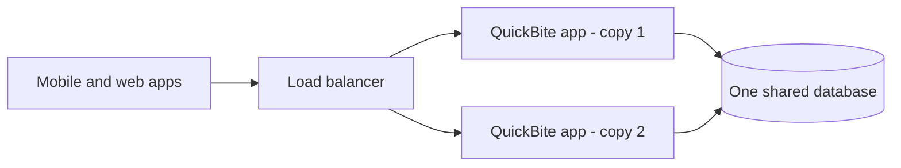
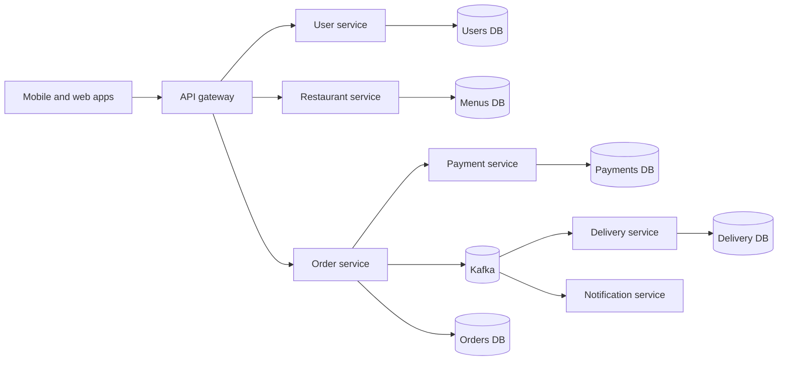
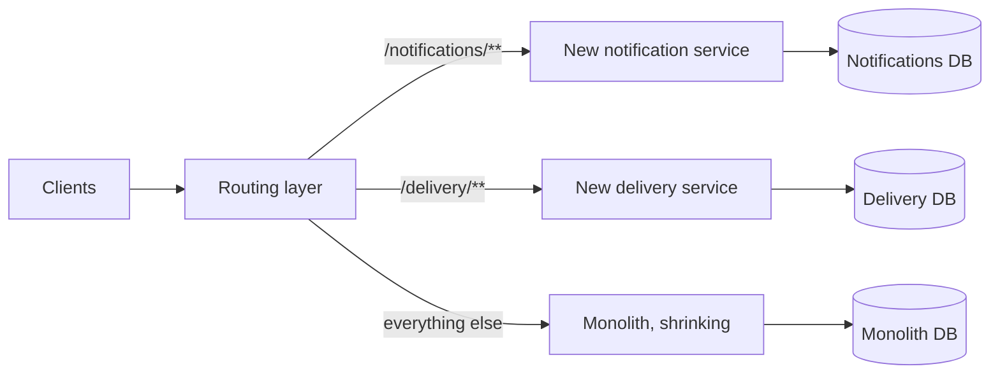

Ask ten developers whether you should use microservices and you'll get eleven opinions. Some will tell you monoliths are legacy junk. Others will tell you microservices are an expensive fashion that half the industry quietly regrets.

I think both camps skip the boring, useful part: what actually changes in your code, your servers and your team when you pick one over the other?

To keep this grounded, I'll use a made-up food-delivery app called **QuickBite** and follow it from a three-person startup to a company with hundreds of engineers. The code is Java and Spring Boot, and I'll explain the jargon as it shows up.

The whole debate really boils down to one question: how many separately running programs make up your application, and how do they talk to each other? Almost everything else falls out of that.

## So what's a monolith?

A **monolith** is an application where every feature lives in one codebase, gets built into one deployable artifact (for Java, usually a single JAR or WAR), and runs as one **process**. A process is just a running program with its own memory.

In QuickBite's case, that one program has user sign-up, restaurant menus, the cart, payments, order tracking, delivery-partner assignment and notifications. When the order code needs a menu, it calls a Java method. That call happens in memory and takes microseconds. Most monoliths also sit on top of a single shared database.

Also, "monolith" doesn't mean "bad code". Plenty of monoliths are clean, well-tested and fast. The word only describes how the app is packaged and deployed.



The **load balancer** in that diagram spreads incoming requests across servers. Notice there are two copies of the app. A monolith can run on as many servers as you like; "one program" doesn't mean "one server".

### The modular monolith

A **modular monolith** is still deployed as one unit, but the code inside is split into modules with real boundaries: `orders`, `restaurants`, `payments`, `delivery`. Each module exposes a small public API (the classes other modules are allowed to call) and keeps everything else, including its tables, to itself.

Think of a house with proper rooms and doors. Same address, same roof, but you can redo the kitchen without ripping up the bedroom floor.

The opposite is what people lovingly call a **big ball of mud**, where any class calls any other class and any query joins any table. Honestly, when someone complains about "the monolith", this is usually what they mean. In Java you can enforce module boundaries with separate Maven or Gradle modules, the Java module system, or tools like Spring Modulith and ArchUnit, which fail the build when one module pokes into another's internals.

## And microservices?

With **microservices**, the application is a set of small services. Each one is built around a single **business capability** (something the business does, like "take payments", as opposed to a technical layer like "the database layer"). Each one can be deployed on its own, so the payments team can ship on a Tuesday afternoon without anyone else redeploying anything. Each one owns its data, and other services can only get at that data by asking the service, never by reading its database. And they all talk to each other over the network, using HTTP, gRPC or messages.

The term took off after James Lewis and Martin Fowler's 2014 article "Microservices".



The **API gateway** is the single entry point for requests from the outside world. **Kafka** is a message broker, a system that holds messages from one service and hands them to others. I'll come back to both.

By the way, "micro" is a terrible name. There's no line-count rule. A service is the right size when one team can own it end to end and change it without a meeting with five other teams.

## QuickBite, built both ways

**Year 1.** Three engineers, one city, one Spring Boot app, one PostgreSQL database. Placing an order is a single **transaction**, meaning a group of database changes that either all happen or all get rolled back: insert the order, reserve the payment, check out the cart. You never end up with half an order.

Deploying is one command. Debugging is one log file and a breakpoint. When the product manager asks for "reorder your last meal", someone builds it in a day, because all the data is one SQL query away.

This is the monolith at its best. If these three had started with twelve microservices, they'd have spent six months on deployment pipelines and network bugs instead of finding customers.

**Year 3.** Ten cities, forty engineers, and the cracks start to show. A full build and test run takes 40 minutes, and five teams push into the same weekly release, so one team's bug holds up everyone's features. The `Order` class is touched by checkout, delivery and promotions, so every change needs three teams to review it. On Friday nights the order-tracking screen gets hammered while restaurant onboarding sits idle, but the only way to scale is to run more copies of the entire app. And when a memory leak in the PDF invoice code crashes the process, customers can't place orders either.

None of this means the monolith was a mistake. The company grew, and the way the code is packaged is now fighting the way the people are organised.

**Year 5.** QuickBite splits into services: users, restaurants, orders, payments, delivery and notifications. Each gets its own team, repo, database and release schedule.

The wins are real. The delivery team ships several times a day without asking anybody. Tracking runs fifty copies on Friday night while the restaurant service runs three. Notifications can crash and orders keep flowing.

But "place an order" is no longer one transaction in one database. It's a conversation between the order, payment and delivery services over the network, and any of them might be slow or down at any moment. Now you need people to run the deployment platform, a tracing setup to follow a request across services, and rules for changing APIs without breaking other teams.

The complexity didn't go anywhere. It moved. A monolith keeps it inside the code, where it's cheap to deal with. Microservices push it into the network and the org chart, where it's expensive, but in exchange teams get to work independently.

## Where each one wins, and where it hurts

**Deployment** is the obvious one. A monolith has one pipeline and one deploy, which is lovely until every tiny change means redeploying everything and five teams are queueing on the same release. Microservices let each team ship on its own schedule. The bill comes as dozens of pipelines, plus the job of making sure different versions running side by side still get along.

**Scaling** (handling more load, usually by running more copies of a program) is where people tend to overestimate the monolith's problem. Ten copies of a well-built monolith behind a load balancer can handle a lot of traffic. It only gets wasteful when one feature needs far more resources than the rest, like QuickBite's tracking screen. Then being able to scale just that part is genuinely useful.

**Team autonomy** is, in my opinion, the strongest real reason to go for microservices. With one or two teams, a monolith is fine. With twenty, the coordination cost of a shared codebase and a shared release starts to eat your week. A team that owns its service from code to production can just get on with it.

**Tech diversity** is overrated. Yes, the fraud team could write its service in Python for the machine learning libraries. But every extra language or database is one more thing someone has to know how to run at 3 a.m., and sensible companies keep the list short. In a monolith, everyone can read everyone's code, and that's a feature.

**Fault isolation** (one part failing without taking down the rest) is something microservices make possible. You still have to build it. In a monolith, a memory leak or a bad deploy hits everything. In microservices, a dead notification service shouldn't stop orders, but only if the callers have been written to cope with it. I've seen plenty of systems where one slow service still took everything down with it.

**Data consistency** is where most teams get a nasty surprise. A monolith has one database with real transactions. With microservices, every service has its own database and there's no transaction that spans them, so for a moment the data will disagree with itself. You have to design for that, and it's a big mental shift.

**Debugging and latency** go together. In a monolith you get one log and one stack trace, and module-to-module calls happen in memory. In microservices, one customer complaint can involve six services, and every call between them is a network round trip (typically around a millisecond or more inside a data centre, plus turning objects into JSON and back). **Latency**, if you haven't met the word, just means how long something takes to respond.

**Operational cost** is the one people underestimate. A monolith needs a few servers, a database and some monitoring. Microservices usually need a container platform like Kubernetes, a message broker, an API gateway, central logging, tracing, and a platform team to keep it all running. Those are real salaries and real cloud bills.

**Testing** flips around too. A monolith's integration tests can boot the whole app and run a full flow. A single microservice is easy to test on its own, but testing them together is painful, so teams lean on **contract tests**, which check that a service still returns what its callers expect.

Here's the same thing as a table, for the skimmers:

| Aspect | Monolith | Microservices |
|---|---|---|
| Deployable units | One | Many, one per service |
| Getting started | Fast and cheap | Slow; needs platform work first |
| Deploying a small change | Redeploy everything | Redeploy one service |
| Scaling | Whole app together | Each service separately |
| Calls between parts | In-memory method calls | Network calls (HTTP, gRPC, messages) |
| Data | Usually one shared database | Database per service |
| Consistency | Database transactions | Eventual consistency, sagas |
| Failure impact | Can take down the whole app | Can be contained, if designed for it |
| Debugging | One log, one stack trace | Needs centralised logs and tracing |
| Team fit | One to a few teams | Many independent teams |
| Tech stack | Usually one | Can vary per service |
| Operational cost | Low | High |
| Refactoring across features | Easy: IDE rename across one codebase | Hard: coordinated API changes |

## The hard parts nobody puts on the conference slide

### Network calls fail in weird ways

Inside a monolith, `paymentService.charge(order)` either runs or throws. Over the network, a call can succeed, fail fast, hang for ages, or succeed and then lose the response on the way back. That last one is the nasty one. The payment service charged the customer, the reply vanished, and the order service has no idea whether the money moved.

So every network call needs a bit of paranoia built in. Three tools cover most of it.

A **timeout** caps how long you'll wait. Without one, a slow payment service ties up the order service's threads until the order service stops responding as well, and then whatever calls *it* starts struggling. That chain reaction is called a **cascading failure**.

A **retry** tries again after a failure. It's great for short blips and dangerous when done carelessly. If every caller of a struggling service retries three times, you've just quadrupled its load at the worst possible moment. So you wait a bit longer between each attempt (**exponential backoff**), add some randomness so everyone doesn't retry at the same instant (**jitter**), and you only retry operations that are **idempotent**, meaning doing them twice has the same effect as doing them once. "Get order 42" is idempotent. "Charge Rs. 500" is not, unless you send a unique request ID that the payment service uses to ignore duplicates.

A **circuit breaker** keeps an eye on calls to a dependency. If too many fail, it "opens" and starts failing immediately (often with a fallback answer) instead of calling at all. After a cool-down it lets a few test calls through, and if those work, it closes again. Same idea as the breaker in your house.

Here's what that looks like with Spring Boot's `RestClient` and Resilience4j:

```java
@Configuration
class RestaurantClientConfig {

    @Bean
    RestClient restaurantRestClient() {
        var factory = new SimpleClientHttpRequestFactory();
        factory.setConnectTimeout(Duration.ofMillis(500)); // don't wait forever to connect
        factory.setReadTimeout(Duration.ofSeconds(2));     // or for the reply
        return RestClient.builder()
                .baseUrl("http://restaurant-service")
                .requestFactory(factory)
                .build();
    }
}

@Service
class RestaurantClient {

    private final RestClient restClient;

    RestaurantClient(RestClient restaurantRestClient) {
        this.restClient = restaurantRestClient;
    }

    @CircuitBreaker(name = "restaurants", fallbackMethod = "fallbackMenu")
    public Menu getMenu(long restaurantId) {
        return restClient.get()
                .uri("/restaurants/{id}/menu", restaurantId)
                .retrieve()
                .body(Menu.class);
    }

    // Kicks in when the call fails or the circuit is open
    private Menu fallbackMenu(long restaurantId, Throwable cause) {
        return Menu.unavailable(restaurantId);
    }
}
```

```yaml
resilience4j:
  circuitbreaker:
    instances:
      restaurants:
        sliding-window-size: 20           # look at the last 20 calls
        failure-rate-threshold: 50        # open if half of them failed
        wait-duration-in-open-state: 10s  # then back off for 10s
```

Now when the restaurant service falls over on a Friday night, customers quickly see "menu temporarily unavailable" instead of an app that just spins.

### Every service gets its own database (and that hurts)

The **database-per-service** rule says each service owns its database, and nobody else reads or writes it directly. If the order service wants a restaurant's name, it asks the restaurant service, or keeps its own copy of the couple of fields it needs.

Why so strict? Because a shared database quietly glues services together. If the delivery service reads the `orders` table, the order team can't rename a column without breaking delivery. At that point they aren't really independent anymore, which was the whole reason for splitting them.

The price is that you lose easy joins. A report like "revenue per restaurant per city", which was one SQL query in the monolith, now needs data from three services. Most teams stream data into a separate reporting database for that.

You also lose cross-service transactions. So how do you place an order that touches three services? With a **saga**: a sequence of local steps, each in one service's own database, where every step has a **compensating action** that undoes it if something later fails. For QuickBite:

1. The order service creates the order as `PENDING`.
2. The payment service charges the customer.
3. The delivery service assigns a delivery partner.
4. The order service marks the order `CONFIRMED`.

If step 3 fails because no partner is free, you walk backwards: refund the payment and mark the order `CANCELLED`. It's like booking a trip yourself. You book the flight, then the hotel, and if the hotel's full, you cancel the flight.

Sagas come in two flavours. With **choreography**, each service listens for events and reacts ("payment went through, so I'll find a driver"). With **orchestration**, one coordinator tells everyone what to do next. My rule of thumb: choreography is fine for short flows, but once there are more than a handful of steps, you'll want an orchestrator so a human can actually follow what's going on.

All of this means living with **eventual consistency**: different parts of the system can disagree for a moment, but they'll catch up once things settle. For a second or two after payment, the order service might still say `PENDING` while the payment service already says `PAID`. Your bank app does exactly this when a card payment shows as "pending" for a while. The fix is mostly in the UI. Show "Confirming your order..." rather than pretending everything happened instantly.

### The outbox pattern

The order service saves an order, then publishes an `OrderPlaced` event to Kafka. What happens if it crashes between those two lines? The order exists, nobody hears about it, and no driver ever turns up. Flip the order and you might announce an order that never got saved.

The **outbox pattern** fixes this. In the same transaction that saves the order, you also insert the event into an `outbox` table, so either both rows land or neither does. A separate job then reads the outbox, publishes to Kafka and marks each row as sent.

```java
@Transactional // the order and its outbox row commit together, or not at all
public Order placeOrder(PlaceOrderCommand cmd) throws JsonProcessingException {
    Order order = orders.save(Order.pending(cmd.customerId(), cmd.items()));
    var event = new OrderPlaced(order.getId(), order.getCustomerId(), order.getTotal());
    outbox.save(new OutboxMessage("orders", order.getId().toString(),
            json.writeValueAsString(event)));
    return order;
}

@Scheduled(fixedDelay = 1000)
void publishPending() {
    for (OutboxMessage msg : outbox.findTop100BySentFalseOrderByIdAsc()) {
        kafka.send(msg.getTopic(), msg.getKey(), msg.getPayload()).join(); // wait for Kafka's ack
        msg.markSent();
        outbox.save(msg);
    }
}
```

If the publisher dies after sending but before marking the row, that event goes out twice. That's expected. The outbox gives you **at-least-once** delivery, so consumers need to handle duplicates, usually by remembering which event IDs they've already processed. Bigger setups often swap the polling loop for a change-data-capture tool like Debezium, which reads the database's transaction log and publishes outbox rows for you.

### Finding each other, and a front door

In a monolith, nothing needs finding. With microservices, the order service has to know where the payment service is running *right now*, and that keeps changing as copies start, stop and move around. **Service discovery** handles that; think of a phone directory that updates itself. On Kubernetes it's built in: you call `http://payment-service` and the platform routes you to a healthy copy. Outside Kubernetes, Consul or Netflix's Eureka do the same job.

The QuickBite mobile app shouldn't need to know there are twelve services behind it, either. That's the **API gateway**'s job. It routes `/orders/**` to the order service and `/menus/**` to the restaurant service, and handles shared chores in one place, like checking login tokens and **rate limiting** (capping how many requests a client can make). Spring Cloud Gateway, Kong, NGINX and the cloud providers' managed gateways are the usual suspects. Please keep business logic out of it, though. A gateway that decides discount rules is just a new monolith that every team has to edit.

### Logs, metrics and traces

**Observability** is a fancy word for how well you can tell what your system is doing from the data it spits out. In practice that's three things. **Logs** are text records of what happened ("payment 981 failed: card declined"), and with fifty services they have to be shipped somewhere central and searchable, like the ELK stack or Grafana Loki. **Metrics** are numbers over time (requests per second, error rate, response time per service), often collected with Prometheus and graphed in Grafana.

The third one is **distributed tracing**, and it's the one you'll miss most. Each incoming request gets a unique **trace ID**, every service passes it along, and each records how long its part took. So when someone says checkout is slow, you pull up the trace and see that 2.8 of the 3 seconds went to the promotions service. OpenTelemetry is the standard way to produce this data, and Jaeger, Zipkin or Grafana Tempo will show it to you.

### Changing APIs without breaking people

When the payment team changes its API, it can't make every caller update on the same day. That would drag you right back to coordinated releases. So APIs have to stay **backward compatible**: add fields instead of renaming or removing them, make new fields optional, and when you truly have to break something, run `/v1` and `/v2` side by side until everyone has moved. Kafka event formats need the same care, and a schema registry can reject incompatible changes before they hit production.

### The distributed monolith

This is the one I'd warn you about the most. A **distributed monolith** is a set of services that are separate programs but can't be changed, deployed or run on their own. You get all the costs of microservices and none of the benefits.

How do you know you've got one? Shipping a feature means deploying four services in a particular order. Services read each other's tables. One request sets off a long chain of synchronous calls, so if any service is down, everything is. Or there's a shared library full of domain classes that every service has to upgrade at the same time.

Often the honest fix is to merge some services back together, or redraw the boundaries.

## Sync or async?

**Synchronous** communication means the caller waits for the answer before carrying on, like a phone call. REST with JSON is the default: easy to read, easy to poke at with `curl`. **gRPC**, from Google, sends compact binary messages over HTTP/2 with the API defined in `.proto` files. It's faster and more strictly typed, but harder to inspect by hand.

Use sync calls when the caller really needs the answer now, like the checkout page needing today's price. The catch is that the caller only works while the callee is up. If A calls B, which calls C, which calls D, then A is only as available as all four combined.

**Asynchronous** messaging is more like sending a WhatsApp message. You send it and get on with your day. A broker like Kafka or RabbitMQ holds the message until the receivers process it. When QuickBite's order service publishes `OrderPlaced`, the delivery, notification and analytics services each pick it up in their own time. If notifications are down for ten minutes, the messages just wait in Kafka, and the order service never knows anything happened.

On the receiving end, a Spring Kafka consumer is just an annotated method:

```java
@Component
class DeliveryAssigner {

    @KafkaListener(topics = "orders", groupId = "delivery-service")
    void onOrderPlaced(OrderPlaced event) {
        // find a nearby delivery partner; this may run twice for the same event, so be idempotent
    }
}
```

The sending side is the outbox publisher from earlier. My rough rule: sync when a user is sitting there waiting for the answer, async for "this happened, whoever cares can react". Most real systems use both.

## Conway's Law, or why this is really about people

In 1968, Melvin Conway published an observation that's now called **Conway's Law**: organisations design systems that mirror their own communication structure.

It's why microservices are as much an org decision as a technical one. If QuickBite has one team of eight and splits the code into eight services, every engineer gets a service, everyone still talks to everyone, and the boundaries help nobody. If QuickBite has twenty teams in one codebase, they'll trip over each other, and the code will slowly tangle along the lines where they collide.

Some companies run the law in reverse (the so-called "inverse Conway manoeuvre"): decide the system boundaries you want, then shape the teams to match. Amazon's "two-pizza team" idea, teams small enough to be fed by two pizzas, comes from the same place.

The practical upshot is that service boundaries should follow team and business boundaries. If no team would own a service, it probably shouldn't exist. Domain-Driven Design's bounded contexts (areas of the business with their own consistent model and language) are one of the best tools I know for finding those lines.

## So which one should you pick?

A few questions I'd ask before anything else.

How many teams will work on this over the next year or two? If the answer is one or two, I'd go with a monolith almost every time.

Do you actually understand the domain yet? Early boundaries are usually wrong. Moving code between modules is an afternoon's work. Moving it between services, with data migrations and API changes, can take months.

Do some parts of the system have wildly different load or reliability needs? If tracking gets far more traffic than everything else, that's a solid reason to pull it out. Same if teams are constantly blocked on each other's releases.

And can you afford the platform? Automated deployments, central logging, tracing, and on-call for a pile of services. If the honest answer is "not really", that settles it.

For a startup still figuring out what customers want, a small team, an internal tool, or a domain that needs strong consistency everywhere, a modular monolith is the right call. You get most of the clean-boundary benefits without the network tax, and you can still pull services out later.

Martin Fowler made this argument in his 2015 article "MonolithFirst". He'd noticed that almost every successful microservices story he'd heard started as a monolith that grew too big and was then broken up, while systems built as microservices from day one often got into serious trouble. The reasoning is simple: you only learn where the right boundaries are by living with the system for a while.

The famous stories get mangled a lot, so here's what actually happened.

**Netflix** started moving from its own data centres to AWS after a major database corruption in 2008 disrupted DVD shipments for several days. Over the following years it rebuilt its monolith as hundreds of cloud services, and it finished the cloud migration in early 2016. Along the way it open-sourced a bunch of tools, including Eureka for service discovery and Hystrix, an early circuit-breaker library.

**Amazon Prime Video** went the other way, at least for one system. In a 2023 post on its tech blog, the team described rebuilding an audio/video quality-monitoring service. The original design used distributed components on AWS Step Functions and Lambda (serverless functions), and it hit scaling limits and high costs from shuffling data between those components. They moved it into a single process on Amazon ECS and reported cutting that service's infrastructure cost by over 90%. Note the scope, though: that's one monitoring service, not all of Prime Video, and it doesn't prove microservices are bad. It does show that slicing work too finely can cost more than it saves.

**Shopify** runs one of the largest Ruby on Rails codebases around as a modular monolith. In 2019, its engineering team wrote about "deconstructing the monolith" into well-defined components inside one codebase rather than splitting it into services, and later open-sourced Packwerk, a tool for enforcing boundaries between those components.

None of these settles the debate. They're specific companies solving specific problems at a specific size.

## Moving off a monolith: the strangler fig

Say QuickBite decides it's time to pull services out. Please don't do the big rewrite, where you freeze the monolith and build the shiny new system next to it. These almost always take far longer than planned, and the old system keeps changing underneath you.

The **strangler fig pattern** is the saner route. Martin Fowler named it after a fig that grows around a host tree and slowly replaces it. You put a routing layer in front of the monolith, like an API gateway or a reverse proxy (a server that forwards requests to other servers). Then you pick one well-bounded capability (notifications is a nice first one, few dependencies and not much can go wrong), build it as a new service with its own data, and shift traffic to it, a small percentage first and then all of it. Then you delete the old code from the monolith, a step people love to skip and then regret. Rinse and repeat.



The code is rarely the hard part. The data is. Make the new service the owner of its data, and have the monolith either call it or consume its change events. Don't let both write to the same tables.

And if your monolith is a big ball of mud, modularise it first. Once you've drawn clean module boundaries inside the monolith, you'll know where the service boundaries belong, and each extraction gets a lot smaller.

## Before you split anything

A quick sanity check:

- [ ] You can name the concrete problem (team contention, uneven load, isolation) that a modular monolith can't solve.
- [ ] Every service has one owning team and owns its own data.
- [ ] Every network call has a timeout, and retries back off and only hit idempotent operations.
- [ ] Callers have circuit breakers and fallbacks.
- [ ] Cross-service workflows are sagas with real compensating steps, and events go out through an outbox.
- [ ] Logs, metrics and tracing are in place *before* go-live.
- [ ] Each service deploys on its own, and APIs change in backward-compatible ways.
- [ ] You're migrating one piece at a time and deleting the old code as you go.

If you can't tick most of these, stick with a well-structured modular monolith for now. There's no shame in it. Plenty of successful products run on one.
