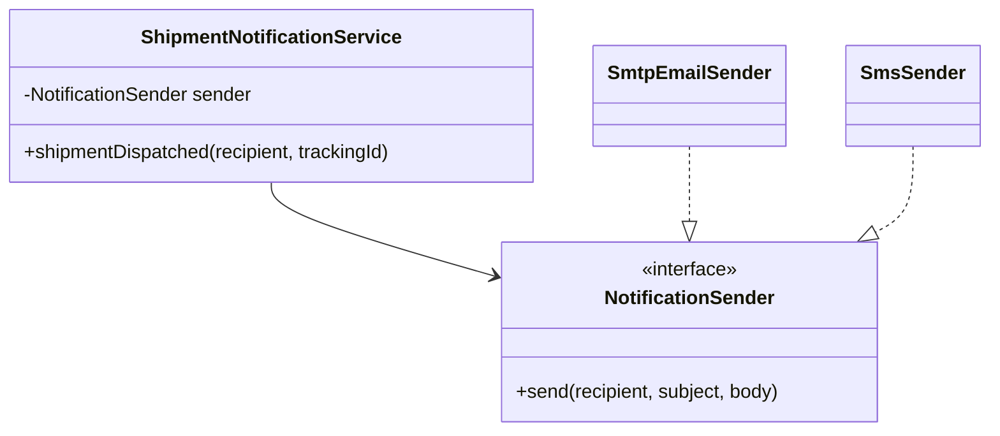

SOLID is an acronym for five object-oriented design principles: the Single Responsibility Principle, the Open-Closed Principle, the Liskov Substitution Principle, the Interface Segregation Principle, and the Dependency Inversion Principle. Together they describe how to arrange classes and their dependencies so that a codebase stays easy to change as requirements grow.

The principles were gathered by Robert C. Martin ("Uncle Bob"), most notably in his 2000 paper *Design Principles and Design Patterns*. Michael Feathers later noticed that their initials spelled SOLID, and the acronym caught on in the early-to-mid 2000s. Two of the five are older than the acronym: the Open-Closed Principle comes from Bertrand Meyer's 1988 book *Object-Oriented Software Construction*, and the Liskov Substitution Principle comes from Barbara Liskov's 1987 keynote *Data Abstraction and Hierarchy*.

This article walks through each principle using everyday backend code (orders, payments, bank accounts, notifications) rather than shapes and animals. For each one you will see what it says, a "before" version that violates it, an "after" refactor, how to spot violations in a review, and the ways people commonly misread or overuse it.

## Why SOLID Matters

Most code is written once and changed many times. The cost of a codebase is rarely in typing the first version; it is in every later change: a new payment method, a new notification channel, a new tax rule. Code that ignores these principles tends to show the same symptoms:

- **Rigidity**: a small change forces edits in many places.
- **Fragility**: a change in one place breaks something that seems unrelated.
- **Immobility**: useful code cannot be reused because it is tangled with other concerns.
- **Hard-to-test code**: you cannot test business logic without a real database, SMTP server, or payment gateway.

SOLID is a set of heuristics for keeping those symptoms in check. These are not laws, and applying them mechanically causes its own problems, which we will get to near the end.

## S - Single Responsibility Principle (SRP)

### What It Says

> A class should have only one reason to change.

Robert C. Martin later refined this in *Clean Architecture* (2017): "A module should be responsible to one, and only one, actor." An actor is a group of people who request changes, such as the finance team, the operations team, or the marketing team. SRP is not "a class should do one thing"; it is "a class should serve one source of change".

### Before: An Order Service That Does Everything

```java
public class OrderService {

    private final DataSource dataSource;

    public OrderService(DataSource dataSource) {
        this.dataSource = dataSource;
    }

    public void placeOrder(Order order) throws SQLException {
        // 1. Validation (product team rules)
        if (order.items().isEmpty()) {
            throw new IllegalArgumentException("Order has no items");
        }

        // 2. Pricing and tax (finance rules)
        BigDecimal subtotal = order.items().stream()
                .map(i -> i.unitPrice().multiply(BigDecimal.valueOf(i.quantity())))
                .reduce(BigDecimal.ZERO, BigDecimal::add);
        BigDecimal total = subtotal.multiply(new BigDecimal("1.18")); // 18% GST

        // 3. Persistence (database schema)
        try (Connection c = dataSource.getConnection();
             PreparedStatement ps = c.prepareStatement(
                     "INSERT INTO orders (id, customer_email, total) VALUES (?, ?, ?)")) {
            ps.setString(1, order.id());
            ps.setString(2, order.customerEmail());
            ps.setBigDecimal(3, total);
            ps.executeUpdate();
        }

        // 4. Notification (marketing wording, SMTP details)
        Properties props = new Properties();
        props.put("mail.smtp.host", "smtp.example.com");
        Session session = Session.getInstance(props);
        try {
            MimeMessage msg = new MimeMessage(session);
            msg.setRecipients(Message.RecipientType.TO, order.customerEmail());
            msg.setSubject("Thanks for your order " + order.id());
            msg.setText("Your total is " + total);
            Transport.send(msg);
        } catch (MessagingException e) {
            throw new IllegalStateException("Could not send confirmation", e);
        }
    }
}
```

### Why It Hurts

This one method has at least four reasons to change: the product team changes validation rules, finance changes the tax rate, a DBA renames a column, or marketing rewrites the email. Every one of those changes touches the same file, so they collide in merges and risk breaking each other. Testing the tax calculation requires a database and an SMTP server, and you cannot reuse the pricing logic for a "preview cart total" endpoint without dragging the JDBC and mail code along.

### After: One Class per Reason to Change

```java
public record OrderItem(String sku, BigDecimal unitPrice, int quantity) {}

public record Order(String id, String customerEmail, List<OrderItem> items) {}

public class OrderValidator {
    public void validate(Order order) {
        if (order.items().isEmpty()) {
            throw new IllegalArgumentException("Order has no items");
        }
    }
}

public class PriceCalculator {
    private static final BigDecimal GST = new BigDecimal("1.18");

    public BigDecimal total(Order order) {
        BigDecimal subtotal = order.items().stream()
                .map(i -> i.unitPrice().multiply(BigDecimal.valueOf(i.quantity())))
                .reduce(BigDecimal.ZERO, BigDecimal::add);
        return subtotal.multiply(GST);
    }
}

public interface OrderRepository {
    void save(Order order, BigDecimal total);
}

public interface OrderNotifier {
    void orderPlaced(Order order, BigDecimal total);
}

public class OrderService {
    private final OrderValidator validator;
    private final PriceCalculator calculator;
    private final OrderRepository repository;
    private final OrderNotifier notifier;

    public OrderService(OrderValidator validator, PriceCalculator calculator,
                        OrderRepository repository, OrderNotifier notifier) {
        this.validator = validator;
        this.calculator = calculator;
        this.repository = repository;
        this.notifier = notifier;
    }

    public void placeOrder(Order order) {
        validator.validate(order);
        BigDecimal total = calculator.total(order);
        repository.save(order, total);
        notifier.orderPlaced(order, total);
    }
}
```

The JDBC code moves into a `JdbcOrderRepository implements OrderRepository`, and the mail code moves into an `EmailOrderNotifier implements OrderNotifier`. `OrderService` now has a single job: coordinating the workflow of placing an order. Finance can change `PriceCalculator` without touching anything else, and the calculator can be unit-tested with plain objects.

### How to Spot Violations

- The class name ends in `Manager`, `Helper`, `Util`, or `Processor` and the class is hundreds of lines long.
- The import list mixes layers: `java.sql`, `jakarta.mail`, HTTP clients, and domain types in one file.
- Describing the class needs the word "and": "it validates *and* prices *and* saves *and* emails".
- Unrelated changes, made for different stakeholders, keep landing in the same file in your Git history.

### Common Misreadings and Pitfalls

- **"One method per class."** SRP is about reasons to change, not about counting methods. A `PriceCalculator` with ten closely related pricing methods is fine.
- **Splitting too early.** Breaking a 40-line class into six classes with one line each scatters logic and makes it harder to follow. Split when you can name the different actors, not before.
- **Confusing SRP with "do one thing".** "Do one thing" is advice for *functions*. SRP is about *modules* and who asks for changes to them.

## O - Open-Closed Principle (OCP)

### What It Says

> Software entities (classes, modules, functions) should be open for extension but closed for modification.

Bertrand Meyer stated this in 1988, originally in terms of inheritance: you extend a finished class by subclassing it rather than editing it. Robert C. Martin reframed it in the 1990s around abstractions and polymorphism: depend on an interface, and add new behaviour by adding new implementations instead of editing existing, tested code.

### Before: A Switch on Payment Type

```java
public enum PaymentType { CARD, UPI, NET_BANKING }

public record PaymentRequest(String orderId, BigDecimal amount, PaymentType type,
                             Map<String, String> details) {}

public record PaymentResult(boolean success, String reference) {}

public class PaymentService {

    public PaymentResult pay(PaymentRequest request) {
        switch (request.type()) {
            case CARD -> {
                // call the card gateway with card token
                return new PaymentResult(true, "CARD-" + request.orderId());
            }
            case UPI -> {
                // send a collect request to the UPI handle
                return new PaymentResult(true, "UPI-" + request.orderId());
            }
            case NET_BANKING -> {
                // redirect to the bank
                return new PaymentResult(true, "NB-" + request.orderId());
            }
            default -> throw new IllegalArgumentException("Unsupported: " + request.type());
        }
    }
}
```

### Why It Hurts

Every new payment method, say a wallet or "buy now, pay later", means editing `PaymentService`, the enum, and probably the tests for every existing branch. The class grows without limit, every gateway's SDK ends up on its classpath, and a bug introduced while adding wallets can break card payments, which were working fine.

### After: One Processor per Payment Method

```java
public interface PaymentProcessor {
    boolean supports(PaymentType type);
    PaymentResult process(PaymentRequest request);
}

public class CardPaymentProcessor implements PaymentProcessor {
    public boolean supports(PaymentType type) { return type == PaymentType.CARD; }

    public PaymentResult process(PaymentRequest request) {
        // call the card gateway with card token
        return new PaymentResult(true, "CARD-" + request.orderId());
    }
}

public class UpiPaymentProcessor implements PaymentProcessor {
    public boolean supports(PaymentType type) { return type == PaymentType.UPI; }

    public PaymentResult process(PaymentRequest request) {
        // send a collect request to the UPI handle
        return new PaymentResult(true, "UPI-" + request.orderId());
    }
}

public class PaymentService {
    private final List<PaymentProcessor> processors;

    public PaymentService(List<PaymentProcessor> processors) {
        this.processors = List.copyOf(processors);
    }

    public PaymentResult pay(PaymentRequest request) {
        return processors.stream()
                .filter(p -> p.supports(request.type()))
                .findFirst()
                .orElseThrow(() -> new IllegalArgumentException(
                        "Unsupported: " + request.type()))
                .process(request);
    }
}
```

Adding a wallet now means adding a `WALLET` constant and a `WalletPaymentProcessor`, then registering it. `PaymentService` and the existing processors do not change, and their tests keep passing. (If the type were a plain string or the processors were discovered by a DI container, even the enum edit would disappear.)

### How to Spot Violations

- `switch` or `if/else if` chains on a type code that appear in more than one place.
- A list of recent commits where every new feature edits the same central class.
- `instanceof` checks that decide behaviour for each subtype.

### Common Misreadings and Pitfalls

- **"Never modify existing code."** Bug fixes and genuine requirement changes require modification. OCP is about the *axis of change you expect*, such as new payment methods, not about freezing files.
- **Abstracting every switch.** A `switch` over three stable values that is used in one place is simpler than an interface and three classes. Introduce the extension point when the second or third variation actually turns up.
- **Guessing the wrong axis.** If you make payments pluggable but the real churn is in refund rules, you have paid for abstraction you do not use. Let observed change guide where you put the seams.

## L - Liskov Substitution Principle (LSP)

### What It Says

> If S is a subtype of T, then objects of type T may be replaced with objects of type S without breaking the correctness of the program.

Barbara Liskov introduced the idea in her 1987 keynote *Data Abstraction and Hierarchy*, and she and Jeannette Wing formalised it in 1994. In practical terms, a subclass must honour the *contract* of its parent: it can accept more (weaker preconditions) and promise more (stronger postconditions), but it must not demand more or deliver less, and it must not break the parent's invariants.

### Before: A Fixed Deposit That Cannot Withdraw

```java
public class Account {
    protected BigDecimal balance = BigDecimal.ZERO;

    public void deposit(BigDecimal amount) {
        balance = balance.add(amount);
    }

    public void withdraw(BigDecimal amount) {
        if (amount.compareTo(balance) > 0) {
            throw new InsufficientFundsException();
        }
        balance = balance.subtract(amount);
    }

    public BigDecimal balance() { return balance; }
}

public class SavingsAccount extends Account {}

public class FixedDepositAccount extends Account {
    @Override
    public void withdraw(BigDecimal amount) {
        throw new UnsupportedOperationException("Funds are locked until maturity");
    }
}

public class SalaryDeductionJob {
    public void deductEmi(List<Account> accounts, BigDecimal emi) {
        for (Account account : accounts) {
            account.withdraw(emi); // blows up for fixed deposits
        }
    }
}
```

### Why It Hurts

`SalaryDeductionJob` was written against `Account`, whose contract says "withdraw succeeds when the balance is enough". A `FixedDepositAccount` *is-a* `Account` in the banking sense, but it breaks that promise. Callers now need `if (account instanceof FixedDepositAccount)` checks, which is exactly the type-switching OCP warns against. This is the same trap as the classic Rectangle/Square problem: a real-world "is-a" relationship is not the same as behavioural substitutability.

The JDK has a well-known example too. `List.of(...)` returns a `List` whose `add` throws `UnsupportedOperationException`. Any method that accepts a `List` and adds to it will fail at runtime when given that list. The Collections designers accepted this trade-off on purpose (the methods are documented as "optional operations"), but in your own domain code it is usually a design smell.

### After: Model the Capability Explicitly

```java
public abstract class Account {
    protected BigDecimal balance = BigDecimal.ZERO;

    public void deposit(BigDecimal amount) {
        balance = balance.add(amount);
    }

    public BigDecimal balance() { return balance; }
}

public interface Withdrawable {
    void withdraw(BigDecimal amount);
}

public class SavingsAccount extends Account implements Withdrawable {
    @Override
    public void withdraw(BigDecimal amount) {
        if (amount.compareTo(balance) > 0) {
            throw new InsufficientFundsException();
        }
        balance = balance.subtract(amount);
    }
}

public class FixedDepositAccount extends Account {
    private final LocalDate maturityDate;

    public FixedDepositAccount(LocalDate maturityDate) {
        this.maturityDate = maturityDate;
    }

    public LocalDate maturityDate() { return maturityDate; }
}

public class SalaryDeductionJob {
    public void deductEmi(List<? extends Withdrawable> accounts, BigDecimal emi) {
        accounts.forEach(a -> a.withdraw(emi));
    }
}
```

Now the compiler stops you from passing a fixed deposit to `deductEmi`. Every `Withdrawable` really can be withdrawn from, and every `Account` really can accept deposits and report a balance.

### How to Spot Violations

- Overrides that throw `UnsupportedOperationException` or have empty bodies.
- `instanceof` checks on a subtype before calling a method on the base type.
- Subclasses that add preconditions ("amount must be a multiple of 100") or skip side effects the parent guarantees.
- Tests written for the base class that fail when run against a subclass.

### Common Misreadings and Pitfalls

- **"LSP is about method signatures."** The compiler already checks signatures. LSP is about *behaviour*: exceptions, side effects, invariants, and the assumptions callers make.
- **Inheriting for reuse.** Extending a class just to reuse its code is the most common route to LSP violations. Prefer composition when the subtype cannot honour the full contract.
- **Over-documenting instead of redesigning.** Writing "may throw if this is a fixed deposit" in the Javadoc does not fix the problem; every caller still has to remember it.

## I - Interface Segregation Principle (ISP)

### What It Says

> Clients should not be forced to depend on methods they do not use.

Robert C. Martin developed this principle while consulting for Xerox, where a single large `Job` class was used by almost every task in a printer system (printing, stapling, and so on). Every task depended on methods it never called, so any change to the class forced long rebuilds of everything. The fix was to give each client a narrow interface of its own.

### Before: A Fat Office Device Interface

```java
public interface OfficeDevice {
    void print(Document doc);
    void scan(Document doc);
    void fax(Document doc, String number);
    void staple(Document doc);
}

public class BasicLaserPrinter implements OfficeDevice {
    public void print(Document doc) { /* send to print engine */ }

    public void scan(Document doc) {
        throw new UnsupportedOperationException("No scanner");
    }

    public void fax(Document doc, String number) {
        throw new UnsupportedOperationException("No fax");
    }

    public void staple(Document doc) {
        throw new UnsupportedOperationException("No stapler");
    }
}

public class InvoicePrintingService {
    private final OfficeDevice device;

    public InvoicePrintingService(OfficeDevice device) { this.device = device; }

    public void printInvoice(Document invoice) { device.print(invoice); }
}
```

### Why It Hurts

`BasicLaserPrinter` has to implement three methods it cannot support, which is also an LSP violation waiting to happen. `InvoicePrintingService` only prints, yet it depends on the whole interface, so adding `duplex()` to `OfficeDevice` forces every implementation and every test double to change, even though invoices do not care. Mocks get bigger, and the interface says nothing about what a client actually needs.

### After: Role Interfaces

```java
public interface Printer {
    void print(Document doc);
}

public interface Scanner {
    void scan(Document doc);
}

public interface FaxMachine {
    void fax(Document doc, String number);
}

public class BasicLaserPrinter implements Printer {
    public void print(Document doc) { /* send to print engine */ }
}

public class MultiFunctionPrinter implements Printer, Scanner, FaxMachine {
    public void print(Document doc) { /* ... */ }
    public void scan(Document doc) { /* ... */ }
    public void fax(Document doc, String number) { /* ... */ }
}

public class InvoicePrintingService {
    private final Printer printer;

    public InvoicePrintingService(Printer printer) { this.printer = printer; }

    public void printInvoice(Document invoice) { printer.print(invoice); }
}
```

Each client depends only on the role it uses. A test for `InvoicePrintingService` can pass a lambda, `doc -> printed.add(doc)`, because `Printer` has a single abstract method.

The same idea applies to repositories. A reporting job that only reads orders should depend on an `OrderReader` with `findById` and `findByCustomer`, not on a repository that also exposes `delete` and `bulkUpdate`.

### How to Spot Violations

- Implementations full of `UnsupportedOperationException` or no-op methods.
- Mocks where most methods are stubbed with "never called".
- Interfaces with names like `IService` or `Manager` and fifteen or more methods used by different clients.

### Common Misreadings and Pitfalls

- **One method per interface everywhere.** Splitting `Printer` into `PrintsColour`, `PrintsMono`, and `PrintsA4` makes code harder to read. Group methods that the *same client* uses together.
- **Splitting based on the implementation.** Segregate by what clients need, not by how the implementing class is organised.

## D - Dependency Inversion Principle (DIP)

### What It Says

> High-level modules should not depend on low-level modules. Both should depend on abstractions. Abstractions should not depend on details; details should depend on abstractions.

Robert C. Martin described this in a 1996 *C++ Report* article. The "inversion" is about ownership: the high-level policy (the business rule) defines the interface it needs, and the low-level detail (SMTP, JDBC, an HTTP client) implements it. The source-code dependency then points from the detail towards the policy, against the flow of control.

DIP is related to, but not the same as, dependency injection. DIP is a design rule about which way dependencies point; dependency injection (passing collaborators in, usually through the constructor) is a technique that makes DIP easy to apply.

### Before: Hard-Wired Infrastructure

```java
public class SmtpEmailSender {
    public void send(String to, String subject, String body) {
        // jakarta.mail code talking to smtp.example.com
    }
}

public class ShipmentNotificationService {
    private final SmtpEmailSender emailSender = new SmtpEmailSender();

    public void shipmentDispatched(String customerEmail, String trackingId) {
        emailSender.send(customerEmail, "Your order has shipped",
                "Track it here: https://track.example.com/" + trackingId);
    }
}
```

### Why It Hurts

The business rule ("tell the customer when the shipment leaves") is welded to SMTP. You cannot unit-test it without a mail server, you cannot add SMS or WhatsApp without editing it, and moving to a hosted email API means changing business code. The `new` keyword inside the class is the giveaway.

### After: The Policy Owns the Abstraction

```java
public interface NotificationSender {
    void send(String recipient, String subject, String body);
}

public class ShipmentNotificationService {
    private final NotificationSender sender;

    public ShipmentNotificationService(NotificationSender sender) {
        this.sender = sender;
    }

    public void shipmentDispatched(String recipient, String trackingId) {
        sender.send(recipient, "Your order has shipped",
                "Track it here: https://track.example.com/" + trackingId);
    }
}

public class SmtpEmailSender implements NotificationSender {
    public void send(String recipient, String subject, String body) {
        // jakarta.mail code
    }
}

public class SmsSender implements NotificationSender {
    public void send(String recipient, String subject, String body) {
        // SMS gateway call; subject ignored
    }
}
```

The test needs no infrastructure:

```java
@Test
void notifiesCustomerWhenShipmentLeaves() {
    List<String> sent = new ArrayList<>();
    NotificationSender fake = (to, subject, body) -> sent.add(to + "|" + body);

    new ShipmentNotificationService(fake)
            .shipmentDispatched("asha@example.com", "TRK123");

    assertThat(sent).containsExactly(
            "asha@example.com|Track it here: https://track.example.com/TRK123");
}
```

The `OrderRepository` and `OrderNotifier` interfaces from the SRP section follow the same rule: `OrderService` lives in the domain layer, owns those interfaces, and never imports JDBC or mail classes.



### How to Spot Violations

- `new` used inside business classes to create infrastructure such as clients, repositories, or senders.
- Domain packages importing `java.sql`, HTTP client libraries, or cloud SDKs.
- Static calls to infrastructure singletons (`EmailUtil.send(...)`) inside business logic.
- Tests that need Docker containers just to check a simple business rule.

### Common Misreadings and Pitfalls

- **An interface for every class.** Value objects, records, and stable utilities such as `BigDecimal` or `LocalDate` do not need abstractions. Invert dependencies on things that are volatile or slow: I/O, third-party services, and the clock.
- **Interfaces owned by the wrong side.** If the interface sits in the infrastructure package and mirrors the vendor SDK (`SendGridClientInterface`), the dependency has not really been inverted. Shape the interface around what the business needs.
- **Treating a DI framework as DIP.** Spring wiring a concrete class into another concrete class is still a direct dependency.

## How the Principles Relate to Each Other

The five principles reinforce one another rather than standing alone:

- **SRP gives you the seams.** Once pricing, persistence, and notification live in separate classes, you can put abstractions between them.
- **DIP points the dependencies the right way.** Business code depends on interfaces it owns, such as `OrderRepository` and `NotificationSender`.
- **OCP is the payoff.** With those abstractions in place, new behaviour (a `WalletPaymentProcessor`, an `SmsSender`) arrives as new classes instead of edits.
- **LSP keeps the payoff safe.** Extension through polymorphism only works if every implementation honours the contract. A processor that silently skips refunds breaks the `PaymentService` that trusts it.
- **ISP keeps abstractions small.** Narrow interfaces are easier to implement correctly (helping LSP) and easier to fake in tests (helping DIP).

A useful way to remember it: SRP and ISP are about *drawing boundaries*, DIP is about *the direction of the arrows* across those boundaries, and OCP and LSP are about *extending safely* across them.

## SOLID in Modern Java

Much SOLID advice dates from the days of Java 1.4 and C++, when every abstraction cost a named class. Modern Java makes many of these patterns lighter.

### Lambdas and Functional Interfaces

A single-method interface is a natural ISP-sized role, and lambdas make OCP-style extension cheap. Discount rules are a good example:

```java
@FunctionalInterface
public interface DiscountRule {
    BigDecimal apply(Order order, BigDecimal total);
}

public class DiscountEngine {
    private final List<DiscountRule> rules;

    public DiscountEngine(List<DiscountRule> rules) { this.rules = List.copyOf(rules); }

    public BigDecimal applyAll(Order order, BigDecimal total) {
        BigDecimal result = total;
        for (DiscountRule rule : rules) {
            result = rule.apply(order, result);
        }
        return result;
    }
}

DiscountRule festiveSale = (order, total) -> total.multiply(new BigDecimal("0.90"));
DiscountRule bulkOrder = (order, total) ->
        order.items().size() >= 10 ? total.subtract(new BigDecimal("500")) : total;

DiscountEngine engine = new DiscountEngine(List.of(festiveSale, bulkOrder));
```

A new promotion is a new lambda or class; `DiscountEngine` never changes.

### Records

Records are immutable data carriers with no behaviour to override, so they sidestep many LSP problems (they cannot be extended at all). They also keep data separate from services, which helps SRP: `Order` holds data, `PriceCalculator` holds pricing rules.

### Sealed Interfaces: Deliberately Closed

Sealed types (Java 17) look like the opposite of OCP, and in one sense they are. They are the right tool when the set of variants is fixed and you expect to add *operations* rather than *types*:

```java
public sealed interface PaymentMethod permits Card, Upi, NetBanking {}
public record Card(String token) implements PaymentMethod {}
public record Upi(String vpa) implements PaymentMethod {}
public record NetBanking(String bankCode) implements PaymentMethod {}

public String describe(PaymentMethod method) {
    return switch (method) {
        case Card c -> "Card ending " + c.token().substring(c.token().length() - 4);
        case Upi u -> "UPI " + u.vpa();
        case NetBanking n -> "Net banking via " + n.bankCode();
    };
}
```

Because the `switch` is exhaustive, adding a fourth record makes every such `switch` fail to compile until it is handled. That is the opposite trade-off to the `PaymentProcessor` design: types are closed, operations are open. Use polymorphic interfaces when new *kinds* of things keep arriving, and sealed hierarchies when new *questions* about a fixed set of things keep arriving.

### Spring and Constructor Injection

Spring makes DIP and OCP almost free. Constructor injection keeps dependencies explicit and `final`, and Spring can inject every bean of a type as a list:

```java
@Service
public class PaymentService {
    private final List<PaymentProcessor> processors;

    public PaymentService(List<PaymentProcessor> processors) { // all beans injected
        this.processors = List.copyOf(processors);
    }
    // pay(...) as before
}

@Component
public class WalletPaymentProcessor implements PaymentProcessor { /* ... */ }
```

Adding `WalletPaymentProcessor` as a `@Component` is the entire change; no wiring code is touched. Prefer constructor injection over field injection (`@Autowired` on fields), which hides dependencies and makes classes harder to construct in tests.

## When Not to Apply SOLID

The principles are tools for managing change. Where change is unlikely, they mostly add cost.

- **YAGNI ("You Aren't Gonna Need It").** Do not add a `PaymentProcessor` interface while you support only one payment method and have no plans for a second. Extracting an interface later, with modern IDE refactoring, takes minutes.
- **Over-abstraction.** A request that passes through a controller, a service interface, a service implementation, a facade, a repository interface, and an adapter just to read one row is harder to understand than code without SOLID. Every indirection costs readers something.
- **The single-implementation interface.** `UserService` plus `UserServiceImpl`, with no second implementation and no test double, is ceremony. Mocking libraries can mock concrete classes anyway.
- **Scripts, prototypes, and spikes.** Code you will throw away next week should be written for speed.
- **Performance-critical inner loops.** Rarely, virtual dispatch or allocation in a hot path matters. Measure before you trade design for speed, but know that the trade-off exists.

A good rule of thumb is the "rule of three": put up with duplication or a `switch` the first and second time, and introduce the abstraction when the third variation arrives and you can see the real shape of the change.

## Summary Table

| Principle | In one line | Typical smell | Typical fix |
|-----------|-------------|---------------|-------------|
| Single Responsibility | One actor, one reason to change | God classes, mixed imports | Split by stakeholder or concern |
| Open-Closed | Add behaviour without editing tested code | Repeated `switch` on type | Strategy or plug-in interface |
| Liskov Substitution | Subtypes honour the parent's contract | `UnsupportedOperationException` overrides, `instanceof` checks | Model capabilities explicitly, prefer composition |
| Interface Segregation | Clients see only what they use | Fat interfaces, giant mocks | Role interfaces |
| Dependency Inversion | Policy owns abstractions; details implement them | `new` on infrastructure in business code | Interfaces plus constructor injection |

## Code-Review Checklist

Use these questions when reviewing a pull request:

1. Can I describe each changed class's purpose in one sentence without "and"?
2. Would different teams or stakeholders ask for changes to this class for different reasons?
3. Does this change add another branch to an existing type `switch` that already appears elsewhere?
4. Is the new feature added mainly as new code, or as edits scattered across existing classes?
5. Does any override throw `UnsupportedOperationException`, do nothing, or add a new precondition?
6. Are there `instanceof` checks deciding behaviour for subtypes?
7. Does each client depend on an interface containing only the methods it calls?
8. Do test doubles stub many methods that are never used?
9. Does business code create infrastructure with `new` or call static infrastructure helpers?
10. Do domain packages import JDBC, HTTP, messaging, or cloud SDK types?
11. Are dependencies passed through the constructor and stored in `final` fields?
12. Conversely, does this change add an interface, factory, or layer with only one implementation and no clear reason?

The last question matters as much as the first eleven. SOLID is meant to make change cheap, and a design that is harder to read than the problem it solves has missed that goal, however principled it looks.
